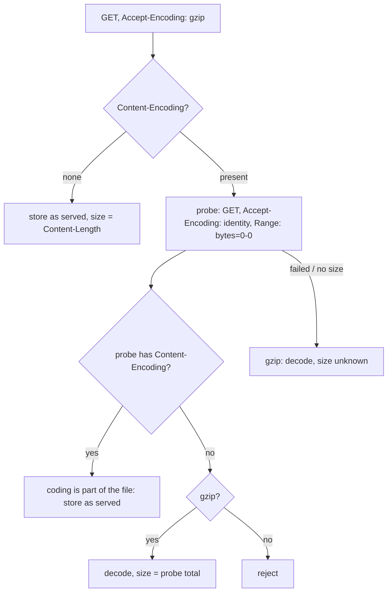

# Transfer Compression and Content Size for HTTP Downloads

* **Status**: proposed
* **Deciders**: OCM maintainers
* **Date**: 2026-10-17

Technical Story: The wget input method streams HTTP downloads straight into the component version instead of
buffering them. It wants gzip on the wire to save bandwidth, but the stored content and its digest must not depend
on whether a server chose to compress, and downstream consumers (OCI packing, HTTP uploads) need the exact content
size up front.

## Context and Problem Statement

HTTP has one header, `Content-Encoding`, for two different things:

* **Negotiated transfer compression.** A server or proxy compresses because the client sent
  `Accept-Encoding: gzip`. A client asking for no compression receives the plain file.
* **Content coding that is part of the stored file.** The server labels a stored, compressed file with
  `Content-Encoding` regardless of what the client accepts, e.g. a `.tar.gz` behind Apache httpd's
  `AddEncoding x-gzip .gz`, or an S3 object uploaded with `Content-Encoding: gzip` metadata.

Decoding the first kind is required for a stable digest; decoding the second kind silently changes the artifact.
A response to a request accepting gzip does not say which kind it is. In addition, a decoded response has no
standard header carrying the decoded length: `Content-Length` is the encoded size, or absent for chunked
responses, so a streaming blob would report an unknown size.

## Decision Drivers

* The stored content and digest are independent of transfer negotiation.
* Stored, compressed artifacts are never changed.
* The content size is known whenever the server can tell it, without buffering the body.
* No extra requests for the common case of uncompressed responses.
* Works with presigned and signed URLs, credentials and redirects.

## Survey

Measured 2026-10-17 by sending, per URL, a `GET` accepting gzip, a `GET` without `Accept-Encoding`, `HEAD`
with and without gzip, and a `GET` with `Accept-Encoding: identity` and `Range: bytes=0-0`. Local instances ran
in Docker with test files: compressible text and JSON, a `.tar.gz`, a pre-compressed `static.txt.gz`, and random
binary data.

| Server                                              | Compresses on gzip request             | Size known when compressed | `HEAD` identity length         | Identity `Range: bytes=0-0` total   | `Content-Encoding` on identity request |
|-----------------------------------------------------|----------------------------------------|----------------------------|--------------------------------|-------------------------------------|----------------------------------------|
| Nexus 3.96.3 CE (local, raw and maven hosted)       | no                                     | n/a                        | correct                        | correct (206)                       | none                                   |
| Artifactory OSS 7.161 (local, router and Tomcat)    | no; sends `x-checksum-*` of the file   | n/a                        | correct                        | correct (206)                       | none                                   |
| Nexus 3.77 PRO, repository.jboss.org (behind proxy) | text (`.pom`)                          | yes                        | missing; gzip `HEAD` says 20   | missing (200, chunked)              | none                                   |
| Apache httpd 2.4, default config                    | no                                     | n/a                        | correct                        | correct                             | none                                   |
| httpd with `mod_deflate` for text types             | text                                   | yes                        | correct                        | correct                             | none                                   |
| httpd with `AddEncoding x-gzip .gz`                 | stored `.gz` always as `x-gzip`        | yes                        | correct                        | correct                             | **x-gzip**                             |
| nginx `gzip on`                                     | text                                   | no (chunked)               | correct                        | correct                             | none                                   |
| nginx `gzip_static on`                              | pre-compressed sibling                 | yes                        | correct                        | correct                             | none                                   |
| S3-compatible (RustFS), object with gzip metadata   | always as stored                       | yes                        | **403** on presigned GET URL   | correct                             | **gzip**                               |
| Maven Central (Cloudflare)                          | `.pom` yes, `.jar` no                  | no (chunked)               | correct                        | correct                             | none                                   |
| npm registry (Cloudflare)                           | JSON                                   | no (chunked)               | missing                        | correct                             | none                                   |
| GitHub raw / API, PyPI (Fastly), nginx.org          | text                                   | yes                        | correct                        | correct                             | none                                   |
| GitHub release assets (signed Azure blob), GCS, Go proxy, any `.tar.gz` / `.jar` | no      | n/a                        | correct                        | correct                             | none                                   |

Findings:

* Artifact repositories do not compress downloads themselves; compression comes from CDNs and reverse proxies,
  and only for text types. No archive or binary was ever served compressed.
* Asking for no compression separates the two kinds of `Content-Encoding`: negotiated compression disappears, a
  content coding that is part of the file stays. Google Cloud Storage documents the same split for objects
  stored with `Content-Encoding: gzip`: they are decompressed unless the request accepts gzip
  ([decompressive transcoding](https://cloud.google.com/storage/docs/transcoding)).
* `HEAD` is not a reliable size source: presigned URLs reject it, some CDNs omit the length, and a gzip `HEAD`
  through a proxy reports the size of a compressed empty body.
* An identity `GET` with `Range: bytes=0-0`, closed after the headers, returned the correct total size for every
  endpoint but one (a proxy answering 200 without a length), including presigned S3 and signed GitHub URLs.
* Checksum headers follow the same split: Maven Central's `x-checksum-sha1` for a pom compressed on the fly is
  that of the plain file; S3 metadata describes the stored, compressed bytes; RFC 9530 `Content-Digest` covers the
  bytes as transferred.

## Considered Options

* Option 1: never negotiate compression; store bytes as served.
* Option 2: negotiate gzip and always decode a gzip response.
* Option 3: negotiate gzip, decode by default, and let users opt out per resource.
* Option 4: negotiate gzip and store what an identity request yields, classifying and sizing compressed
  responses with an identity range probe.

## Decision Outcome

Chosen [Option 4](#option-4): "Store the identity representation; compression is transport only".

Justification:

* The stored content equals what a client asking for no compression receives, so it never depends on
  negotiation, and stored compressed files stay intact without configuration.
* The probe is needed only when a response is actually compressed, which the survey shows is rare for artifacts.
* The probe also yields the content size, so downstream consumers keep an exact `Content-Length`.

### Option 4

#### Description

For the wget input method:

1. Send the request with `Accept-Encoding: gzip`, unless the input specification sets `Accept-Encoding` itself.
2. Without `Content-Encoding`, the response is the content; its size is `Content-Length`.
3. With a `Content-Encoding`, send a probe: the same request with `Accept-Encoding: identity` and
   `Range: bytes=0-0`, closed after the response headers. Only `GET` requests are probed.
   * The probe still carries a `Content-Encoding`: the coding is part of the file. Store the bytes as served;
     the size is the response's `Content-Length`.
   * The probe carries none: the compression was negotiated. A gzip response is decoded while streaming, and its
     size is the probe's `Content-Range` total, or its `Content-Length` when the server ignored the range.
     Other negotiated codings are rejected because they cannot be decoded.
   * The probe fails or reports no size: treat the compression as negotiated and decode, with unknown size.
4. Every size obtained this way is an announced size: a body whose length differs fails the read at its end.
5. `Content-Digest` is verified against the bytes as transferred; all other checksums and the stored digest
   cover the content.

The access type keeps returning the bytes as served without negotiating compression.

#### High-level Architecture

#### Contract

* `download.Request.CompressTransfer` enables the policy; the wget input sets it.
* `download.Blob.Size` reports the content size or `blob.SizeUnknown`; `download.Blob.Decoded` reports whether
  the first response was decoded.
* A reader of a decoded response hands the verifier digests of both the content and the transferred bytes.

## Pros and Cons of the Options

### [Option 1] Never negotiate

Pros:

* No extra requests, exact sizes, no classification.

Cons:

* No bandwidth savings.

### [Option 2] Always decode gzip

Pros:

* Simple; saves bandwidth.

Cons:

* Silently changes stored compressed files (httpd `AddEncoding`, S3 metadata).
* Size unknown for every compressed response.

### [Option 3] Decode by default with a per-resource opt-out

Pros:

* Saves bandwidth; users can fix individual resources.

Cons:

* Users must know how each server labels its files; the default is wrong for stored compressed files.
* Size unknown for every compressed response.

### [Option 4] Identity representation with range probe

Pros:

* Content independent of negotiation, stored compressed files kept, sizes known, no configuration.

Cons:

* One extra request per compressed response; servers answering the probe incorrectly fall back to unknown size
  or fail the read on a length mismatch.

## Discovery and Distribution

Implemented in `bindings/go/wget/internal/download` and enabled by the wget input method. The tutorial
"Working with HTTP Resources" describes the behaviour for users.

## Conclusion

Compression becomes a pure transport optimisation for the wget input: the stored content and digest are those of
the identity representation, compressed artifacts are kept as published, and the content size stays known in all
surveyed setups except one proxy that withholds it.
