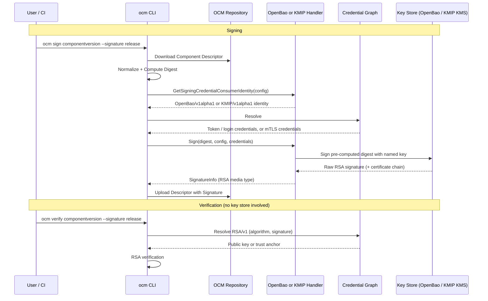

# Remote Signing with OpenBao Transit and KMIP

* **Status**: proposed
* **Deciders**: OCM Technical Steering Committee
* **Date**: 2026.10.15

**Technical Story**: OCM v2 can only sign with key material that is available to the signing process (RSA, GPG) or with keyless Sigstore. Organizations that keep signing keys in an HSM or KMS cannot sign with OCM v2. In OCM v1 this gap was filled by the OCM-specific [signing-server](https://github.com/open-component-model/signing-server). Instead of porting signing-server, OCM v2 signs directly against existing key stores through two standard interfaces: the [OpenBao Transit secrets engine](https://openbao.org/docs/secrets/transit/) and [KMIP](https://docs.oasis-open.org/kmip/kmip-spec/v1.4/kmip-spec-v1.4.html). signing-server is deprecated.

---

## Context and Problem Statement

### signing-server today

* signing-server is a REST service (`POST /sign/rsassa-pss`, `POST /sign/rsassa-pkcs1-v1_5`) authenticated with client certificates (mutual TLS). It signs a client-computed hash with a key file or a PKCS#11 HSM (`pkg/crypto11`) and returns the signature, optionally as a PEM block followed by the signer certificate chain.
* Its known production client is Gardener's CI tooling, which calls the REST API directly from Python ([`gardener/cc-utils` `signingserver.py`](https://github.com/gardener/cc-utils/blob/master/signingserver.py), used by `cli/gardener_ci/sign.py`).
* OCM v1 also ships client handlers `rsa-signingservice` (RSASSA-PKCS1-V1_5) and `rsa-pss-signingservice` (RSASSA-PSS) ([source](https://github.com/open-component-model/ocm/tree/main/api/tech/signing/handlers)), resolving mTLS credentials for the consumer `Signingserver.gardener.cloud`. A code search on github.com and the SAP-internal GitHub found no production use of these handlers.
* Gardener is already replacing signing-server: [`gardener/cc-utils#1777`](https://github.com/gardener/cc-utils/pull/1777) (merged 2026-10-07) adds a Vault Transit client that the PR describes as "a complete drop-in replacement of the existing Signing Server backend". It signs a pre-computed digest (`prehashed=true`) with PSS or PKCS1 v1.5 and returns the certificate chain attached to the Transit key version, producing the same PEM output as signing-server.

### OCM v2 today

* Signing goes through `signing.Handler` (`bindings/go/signing/interface.go`), selected by the runtime type of the signer/verifier specification (`SigningRegistry.GetPlugin`).
* Built-in handlers: RSA (`bindings/go/rsa`, local key material), GPG (`bindings/go/gpg`, local key material), Sigstore (`bindings/go/sigstore`, keyless via the `cosign` binary).
* `Signer.Sign` receives only the descriptor digest (`descruntime.Digest`), never the normalized descriptor. Any remote signer must therefore accept a pre-computed digest.
* When no verifier is configured, `ocm verify` falls back to the RSA verifier (`loadVerifierConfig` in `bindings/go/cli/cmd/verify/component-version/cmd.go`).
* The controller only verifies component versions; it signs nothing outside of tests. Its image is `FROM scratch` (`bindings/go/kubernetes/controller/Dockerfile`), so it cannot load vendor shared libraries.

### The two interfaces

**OpenBao Transit** is an HTTP API of [OpenBao](https://openbao.org), the Linux Foundation fork of HashiCorp Vault:

* `POST /v1/<mount>/sign/<key>` signs base64 input. With `prehashed=true`, `hash_algorithm` (`sha2-256`, `sha2-384`, `sha2-512`, ...) and `signature_algorithm` (`pss` or `pkcs1v15`) it signs a client-computed digest. `salt_length` defaults to `auto` (largest salt). The response is `vault:v<N>:<base64 signature>`, where `N` is the key version.
* `GET /v1/<mount>/keys/<key>` returns the key type and, per key version, the public key.
* `POST /v1/<mount>/keys/<key>/csr` creates a CSR for the key, `POST /v1/<mount>/keys/<key>/set-certificate` attaches a leaf-first certificate chain to a key version. Key material never leaves Transit.
* Since OpenBao 2.7.0 (2026-09-23), **External Keys** let Transit sign with HSM- or KMS-backed keys through KMS plugins, including a PKCS#11 plugin ([GH-3956](https://github.com/openbao/openbao/pull/3956)). OpenBao in front of a PKCS#11 HSM replaces the HSM mode of signing-server.
* Authentication: a token in the `X-Vault-Token` header, obtained directly or through auth methods such as JWT/OIDC (CI identity tokens), Kubernetes (service account tokens) and AppRole.
* HashiCorp Vault exposes the same Transit endpoints; Gardener's client uses them against Vault.

**KMIP** is an OASIS standard protocol implemented by enterprise KMS and HSM products (Thales CipherTrust, Entrust KeyControl, Fortanix DSM, IBM, OVHcloud KMS, Cosmian KMS, HashiCorp Vault Enterprise with the Advanced Data Protection module, ...):

* Binary TTLV (tag-type-length-value) messages over TLS, IANA port 5696. Client authentication is mutual TLS; a KMIP `Credential` (username/password) in the request header is optional and server-specific.
* Managed objects are addressed by a `Unique Identifier` and carry attributes such as `Name`, `Cryptographic Usage Mask` (must include `Sign`), `State` (`Active` is required for signing) and `Link`.
* `Sign` exists since KMIP 1.2. KMIP 1.4 added `Digested Data` to the `Sign` request: the server applies padding and the private-key operation to a client-computed digest.

## Decision Drivers

* Sign with keys that never leave an HSM/KMS, without OCM-operated infrastructure in between
* Use interfaces that existing key stores already expose
* Cover the known signing-server user (Gardener, moving to Vault Transit) and enterprise KMS/HSM users
* Keep verification offline: verifiers (CLI, controller) must not need key store connectivity
* Fit the existing `signing.Handler` contract and credential graph without core changes
* Pure Go, so handlers work in the CLI and the `scratch` controller image
* Minimize new dependencies

## Considered Options

* **Option A**: Two native handlers, OpenBao Transit and KMIP, sharing the RSA signature format
* **Option B**: OpenBao Transit handler only
* **Option C**: KMIP handler only
* **Option D**: Keep signing-server: port the v1 `rsa-signingservice` client to v2, optionally adding a KMIP interface to signing-server
* **Option E**: Native PKCS#11 handler

## Decision Outcome

Chosen [Option A](#option-a-openbao-transit-and-kmip-handlers): OpenBao Transit and KMIP handlers.

Justification:

* OpenBao Transit covers the known signing-server user directly: Gardener's replacement backend uses the same API.
* OpenBao 2.7 External Keys cover PKCS#11-only HSMs without cgo in OCM.
* KMIP covers enterprise KMS/HSM products that do not run OpenBao or Vault.
* Both handlers emit exactly the signature format of the RSA handler, so every existing verifier (including the default RSASSA-PSS verifier) verifies them offline with a public key or certificate.
* The OpenBao handler needs no new dependency (plain JSON over HTTPS). Only the KMIP handler adds one.

The OpenBao Transit handler is implemented first; the KMIP handler follows.

---

## Option A: OpenBao Transit and KMIP Handlers

### Common Design

Both handlers implement `signing.Handler` and are registered as built-ins in the CLI (`bindings/go/cli/internal/plugin/builtin/`), like RSA and GPG.

**Signature format.** Both handlers return a `SignatureInfo` identical to the RSA handler for the same algorithm and encoding policy:

```yaml
# Plain
algorithm: RSASSA-PSS                               # or RSASSA-PKCS1-V1_5
mediaType: application/vnd.ocm.signature.rsa.pss   # application/vnd.ocm.signature.rsa for PKCS1 v1.5
value: <hex signature>
---
# PEM
algorithm: RSASSA-PSS
mediaType: application/x-pem-file
value: <SIGNATURE PEM block followed by the signer certificate chain>
```

**Supported algorithms.** RSA keys only, `RSASSA-PSS` (default) and `RSASSA-PKCS1-V1_5`, with the descriptor digest hashes the RSA handler accepts (`SHA-256`, `SHA-384`, `SHA-512`). ECDSA and ML-DSA keys are rejected because OCM v2 has no verifier for them.

**PSS salt length.** The RSA verifier calls `rsa.VerifyPSS` with nil options, which auto-detects the salt length, so any salt length chosen by the key store verifies. The MGF1 hash must equal the digest hash; key stores that use a different MGF1 hash are not supported.

**Verification.** Verification never contacts the key store. Each handler's `Verify` delegates to the RSA verification logic and its `GetVerifyingCredentialConsumerIdentity` returns the RSA identity (`RSA/v1` with `algorithm` and `signature`), so one public-key credential works with either verifier specification. Users can equally configure the RSA verifier or rely on the default.

**Shared code.** The RSA handler's digest parsing (`parseDigest`), RSA verification and PEM encoding/decoding move from `bindings/go/rsa/signing/handler` into an importable package under `bindings/go/rsa/signing/`, used by all three handlers.

**Controller.** No change. KMIP and OpenBao signatures are RSA signatures, so the controller verifies them with the RSA verifier and the public key from the `.ocmconfig` Secret. Registering the new handlers in the controller is only needed if the controller ever signs.

**Errors.** Handlers fail with an error naming the cause and never fall back silently, for example when the key is not an RSA key, the key store rejects pre-computed digests, or a certificate chain is required (PEM policy) but absent.

### High-level Architecture



### OpenBao Transit Handler

#### Layout

```text
bindings/go/openbao/
├── signing/v1alpha1/                 # OpenBaoSigningConfiguration
├── signing/handler/                  # signing.Handler implementation
├── spec/identity/v1alpha1/           # OpenBao consumer identity
├── spec/credentials/v1alpha1/        # OpenBaoCredentials
└── integration/                      # Test_Integration_* against an OpenBao container
```

The client is plain `net/http` with JSON, using OCM's HTTP client configuration (ADR 0024). No OpenBao or Vault SDK is added.

#### Signer specification

```yaml
type: OpenBaoSigningConfiguration/v1alpha1
# OpenBao address.
address: https://bao.example.com:8200
# Optional OpenBao namespace (X-Vault-Namespace header).
namespace: team-a
# Transit mount path; default "transit".
mountPath: transit
# Transit key name.
key: ocm-release-signing
# Optional key version; 0 or unset signs with the latest version.
keyVersion: 0
# RSASSA-PSS (default) | RSASSA-PKCS1-V1_5. Same values as RSASigningConfiguration.
signatureAlgorithm: RSASSA-PSS
# Plain (default) | PEM. PEM embeds the certificate chain attached to the key version.
signatureEncodingPolicy: Plain
```

#### Signing flow

1. Resolve credentials for the `OpenBao/v1alpha1` identity and obtain a token: use the given token, or log in with the configured auth method. A token obtained by login is reused for further signatures of the same handler instance until its lease expires.
2. `GET /v1/<mount>/keys/<key>`: require an `rsa-*` key (or an external key backed by RSA) with `supports_signing: true`, and determine the key version (configured `keyVersion` or `latest_version`).
3. `POST /v1/<mount>/sign/<key>` with:

   | Field | Value |
   |-------|-------|
   | `input` | base64 of the hex-decoded `digest.value` |
   | `prehashed` | `true` |
   | `hash_algorithm` | `sha2-256` / `sha2-384` / `sha2-512` from `digest.hashAlgorithm` |
   | `signature_algorithm` | `pss` or `pkcs1v15` from `signatureAlgorithm` |
   | `salt_length` | `auto` (PSS only) |
   | `key_version` | the version determined in step 2 |

   Pinning `key_version` guarantees that the signature and the certificate chain belong to the same key version, even if the key is rotated concurrently.
4. Parse `vault:v<N>:<base64>`, check that `N` equals the pinned version, and decode the raw signature.
5. Encode as Plain hex, or as PEM with the certificate chain of key version `N` from step 2. If the PEM policy is selected and the key version has no certificate chain, signing fails.

Minimal OpenBao policy for the signing identity:

```hcl
path "transit/keys/ocm-release-signing" {
  capabilities = ["read"]
}
path "transit/sign/ocm-release-signing" {
  capabilities = ["update"]
}
```

#### Credential consumer identity

```yaml
type: OpenBao/v1alpha1
hostname: bao.example.com
port: "8200"
namespace: team-a   # only if configured
```

#### Credentials (`OpenBaoCredentials/v1alpha1`)

Exactly one authentication method must be configured. Secret fields have an inline form and a `File` form; the inline form takes precedence when both are set, following `RSACredentials/v1`.

| Field | Method | Description |
|-------|--------|-------------|
| `token` / `tokenFile` | Token | OpenBao token used as-is |
| `authMountPath` | JWT, AppRole | Auth method mount path, for example `jwt`, `kubernetes`, `approle` |
| `role` | JWT | Role to log in with |
| `jwt` / `jwtFile` | JWT | JWT to log in with: a CI identity token for the JWT/OIDC auth method, or a Kubernetes service account token for the Kubernetes auth method (both use `POST /v1/auth/<mount>/login` with `role` and `jwt`) |
| `roleID` | AppRole | AppRole role ID |
| `secretID` / `secretIDFile` | AppRole | AppRole secret ID |
| `caCertPEM` / `caCertPEMFile` | all | CA bundle to verify the OpenBao server; system roots if absent |

Example `.ocmconfig` for a CI job with an identity token:

```yaml
type: generic.config.ocm.software/v1
configurations:
- type: signing.config.ocm.software/v1alpha1
  signature: release
  signer:
    type: OpenBaoSigningConfiguration/v1alpha1
    address: https://bao.example.com:8200
    key: ocm-release-signing
    signatureEncodingPolicy: PEM
- type: credentials.config.ocm.software
  consumers:
  - identity:
      type: OpenBao/v1alpha1
      hostname: bao.example.com
      port: "8200"
    credentials:
    - type: OpenBaoCredentials/v1alpha1
      authMountPath: jwt
      role: ocm-release-signer
      jwtFile: /var/run/secrets/ci/id-token
```

#### Key setup

```shell
bao secrets enable transit
bao write transit/keys/ocm-release-signing type=rsa-3072
bao write transit/keys/ocm-release-signing/csr        # sign the CSR with your CA
bao write transit/keys/ocm-release-signing/set-certificate certificate_chain=@chain.pem   # leaf first
```

For HSM-backed keys, the Transit key references an external key configured under `/sys/external-keys` (for example with the PKCS#11 KMS plugin) instead of `type=rsa-3072`.

#### HashiCorp Vault

Vault Transit exposes the same endpoints and request fields, and the handler sends the `X-Vault-Token` / `X-Vault-Namespace` headers both products accept. The handler is therefore expected to work against Vault, but CI tests only OpenBao. Vault is a best-effort target; differences discovered later are fixed in the handler, not worked around by users.

### KMIP Handler

#### Layout

```text
bindings/go/kmip/
├── signing/v1alpha1/                 # KMIPSigningConfiguration
├── signing/handler/                  # signing.Handler implementation
├── spec/identity/v1alpha1/           # KMIP consumer identity
├── spec/credentials/v1alpha1/        # KMIPCredentials
└── integration/                      # Test_Integration_* against a containerized KMIP server
```

The client library is [`github.com/ovh/kmip-go`](https://github.com/ovh/kmip-go): Apache-2.0, pure Go, KMIP 1.0–1.4 including `Sign` with `Digested Data` (`payloads/sign_verify.go`). KMIP 2.x is not needed. Adding it is a new direct dependency of `bindings/go` and is part of this decision.

#### Signer specification

```yaml
type: KMIPSigningConfiguration/v1alpha1
# KMS endpoint; host:port, port defaults to 5696.
endpoint: kms.example.com:5696
# Exactly one of name or uniqueIdentifier.
key:
  name: ocm-release-signing
  # uniqueIdentifier: 3f2a8c1e-...
# RSASSA-PSS (default) | RSASSA-PKCS1-V1_5.
signatureAlgorithm: RSASSA-PSS
# Plain (default) | PEM. PEM embeds the chain from the credentials.
signatureEncodingPolicy: Plain
```

#### Signing flow

1. Resolve credentials for the `KMIP/v1alpha1` identity and open a TLS 1.2+ connection with the client certificate, verifying the server against the configured CA.
2. Negotiate the protocol version (`Discover Versions`) and reject servers below KMIP 1.4.
3. Resolve the key: use `uniqueIdentifier`, or `Locate` by `Name` restricted to object type `Private Key` and state `Active`. Exactly one match is required.
4. Call `Sign`:

   | OCM input | KMIP request field |
   |-----------|--------------------|
   | `signatureAlgorithm: RSASSA-PSS` | `Cryptographic Parameters`: `Cryptographic Algorithm: RSA`, `Padding Method: PSS` |
   | `signatureAlgorithm: RSASSA-PKCS1-V1_5` | `Cryptographic Parameters`: `Cryptographic Algorithm: RSA`, `Padding Method: PKCS1 v1.5` |
   | `digest.hashAlgorithm` | `Cryptographic Parameters`: `Hashing Algorithm` |
   | `digest.value` (hex-decoded) | `Digested Data` |

5. Encode as Plain hex, or as PEM with the chain from the credentials.

The handler fails with a named error if the server negotiates below 1.4 or rejects `Digested Data`, if `Locate` returns zero or several keys, if the key is not `Active` or lacks `Sign` in its `Cryptographic Usage Mask`, or if the padding or hashing algorithm is unsupported.

#### Credential consumer identity

```yaml
type: KMIP/v1alpha1
hostname: kms.example.com
port: "5696"
```

#### Credentials (`KMIPCredentials/v1alpha1`)

| Field | Required | Description |
|-------|----------|-------------|
| `clientCertPEM` / `clientCertPEMFile` | yes | Client certificate for mutual TLS |
| `clientKeyPEM` / `clientKeyPEMFile` | yes | Private key of the client certificate |
| `caCertPEM` / `caCertPEMFile` | no | CA bundle to verify the KMS server; system roots if absent |
| `certificateChainPEM` / `certificateChainPEMFile` | PEM policy only | Signer certificate chain (leaf + intermediates) to embed in PEM signatures |
| `username`, `password` | no | KMIP `Credential` for servers that require it in addition to mTLS |

### Verification Credentials

Identical for both handlers and for locally signed RSA signatures:

```yaml
type: generic.config.ocm.software/v1
configurations:
- type: credentials.config.ocm.software
  consumers:
  - identity:
      type: RSA/v1
      algorithm: RSASSA-PSS
      signature: release
    credentials:
    - type: RSACredentials/v1
      publicKeyPEMFile: /etc/ocm/release-signing.pub.pem   # or a trust anchor for PEM signatures
```

After a key rotation, verifiers keep the previous public keys (or rely on the PEM chain and a trust anchor) to verify component versions signed earlier.

---

## Pros and Cons of the Options

### Option A: OpenBao Transit and KMIP Handlers (Chosen)

Pros:

* Covers Gardener (Vault Transit), OpenBao users, PKCS#11 HSMs behind OpenBao External Keys, and enterprise KMIP products
* No OCM-operated service between OCM and the key store
* Pure Go; works in the CLI and the `scratch` controller image
* Signatures verify offline with the existing RSA verifier
* Private-key operations happen inside the key store, which supports FIPS 140-3 deployments (see ADR 0030)

Cons:

* Two handlers to maintain, each with its own integration test environment
* New direct dependency for KMIP (`github.com/ovh/kmip-go`)
* `Digested Data` (KMIP 1.4) is optional for KMIP servers; products without it cannot be used
* KMIP port 5696 may be blocked in corporate networks; KMIP over HTTPS is not covered

### Option B: OpenBao Transit Only

Pros:

* One handler, no new dependency
* Covers the known signing-server user and PKCS#11 HSMs through OpenBao External Keys

Cons:

* Enterprise KMS/HSM products without OpenBao or Vault in front of them stay unsupported
* Organizations must run OpenBao or Vault only to sign with OCM

### Option C: KMIP Only

Pros:

* One open, vendor-neutral standard

Cons:

* Does not cover the known signing-server user: Gardener moves to Vault Transit, and Vault offers KMIP only in Vault Enterprise with the Advanced Data Protection module
* Open-source OpenBao does not offer a KMIP server

### Option D: Keep signing-server

Pros:

* No change for existing signing-server deployments
* Small client for the REST API

Cons:

* OCM keeps maintaining and operating a security-critical, project-specific service with cgo-based HSM bindings
* A v2 handler for the signing-server REST API becomes a new API that must be deprecated again later, forcing users to migrate twice
* Adding a KMIP interface to signing-server adds a protocol parser to a security-critical service of a deprecated project and only implements a KMIP subset; its known user is moving to Vault Transit, not KMIP

### Option E: Native PKCS#11 Handler

Pros:

* Direct HSM access without a network service
* Broad device support (HSMs, smart cards, YubiKeys)

Cons:

* Requires cgo and dynamically loaded vendor libraries; not usable in the `scratch` controller image and complicates the multi-arch static CLI build
* The vendor library and HSM client configuration must be installed on every signing host
* OpenBao External Keys already reach PKCS#11 HSMs over the network

PKCS#11 remains useful for local devices (for example YubiKeys) and can be added later as an external plugin.

---

## Discovery and Distribution

* Both handlers ship inside the `ocm` CLI as built-ins; no separate installation.
* Config, identity and credential types carry `+ocm:typegen`, `+ocm:jsonschema-gen` and deepcopy markers; schemas and reference docs are produced by `task generate`.
* Integration tests (`Test_Integration_*`) run with testcontainers:
  * `bindings/go/openbao/integration` against the OpenBao container image in dev mode, covering token and JWT login, PSS and PKCS1 v1.5, Plain and PEM, key rotation, and verification with the RSA verifier.
  * `bindings/go/kmip/integration` against an open-source KMIP server. The proof of concept must confirm `Sign` with `Digested Data` against the chosen server before the tests are merged.
* Website how-tos describe signing with OpenBao Transit (including the policy and key setup above) and with KMIP (including the required key attributes `Cryptographic Usage Mask: Sign`, `State: Active`).

## Deprecation of signing-server

signing-server is not ported to OCM v2. Both new handlers replace it, and its known user is already moving to Vault Transit. It is deprecated in three phases, bound to milestones rather than dates.

### Phase 1: Announcement (when this ADR is accepted)

* The signing-server `README.md` and GitHub repository description state that the project is deprecated and link to this ADR.
* signing-server accepts no new features. Security fixes and dependency updates continue.
* The OCM v1 CLI (`open-component-model/ocm`, in maintenance mode per ADR 0016) logs a deprecation warning when `rsa-signingservice` or `rsa-pss-signingservice` is used, and its signing help text marks both as deprecated. The generated legacy reference docs under `website/content_versioned/` are not edited by hand.
* The OCM maintainers inform Gardener of the timeline.

### Phase 2: Replacement available (OpenBao Transit handler released in an OCM v2 CLI minor version)

Entry criteria:

* The OpenBao integration tests pass in CI.
* A component version signed by OCM v1 through signing-server (PEM response) verifies with the OCM v2 RSA verifier. Both use the `application/x-pem-file` `SIGNATURE` block format.
* A Transit key backed by an OpenBao External Key with the PKCS#11 plugin (SoftHSM) signs a pre-computed digest. This confirms the replacement for signing-server's HSM mode.

Actions:

* The website publishes a migration guide (see [Migration mapping](#migration-mapping)).
* signing-server receives security fixes only.

### Phase 3: End of support

Starts when both conditions hold:

* Gardener confirms that its CI no longer calls signing-server (for example, `cc-utils` signs through its Vault Transit backend).
* No other user has reported a dependency on signing-server or the v1 handlers since Phase 1 was announced, or every reported user has a migration path.

Actions:

* A final signing-server release is cut, and the `README.md` states that the project is unmaintained.
* The GitHub repository is archived (read-only).
* Published container images, the Helm chart and the OCM component versions of signing-server stay available and are not deleted.

### What deprecation does not affect

* **Existing signatures.** Signatures produced through signing-server are verified with a public key or certificate by the RSA verifier in OCM v1 and v2. Verification never contacts signing-server.
* **Key material.** Signing keys belong to the operator's key file or HSM, not to signing-server. Retiring signing-server destroys no key.

### Migration mapping

| signing-server setup | OpenBao Transit | KMIP |
|----------------------|-----------------|------|
| Signer `rsa-signingservice` | `OpenBaoSigningConfiguration/v1alpha1`, `signatureAlgorithm: RSASSA-PKCS1-V1_5` | `KMIPSigningConfiguration/v1alpha1`, `signatureAlgorithm: RSASSA-PKCS1-V1_5` |
| Signer `rsa-pss-signingservice` | `OpenBaoSigningConfiguration/v1alpha1`, `signatureAlgorithm: RSASSA-PSS` | `KMIPSigningConfiguration/v1alpha1`, `signatureAlgorithm: RSASSA-PSS` |
| PEM response with certificate chain | `signatureEncodingPolicy: PEM`, chain attached to the key via `set-certificate` | `signatureEncodingPolicy: PEM`, chain in `certificateChainPEM(File)` |
| Server URL | `address`, `mountPath`, `key` | `endpoint`, `key.name` |
| Consumer `Signingserver.gardener.cloud` | `OpenBao/v1alpha1` | `KMIP/v1alpha1` |
| `clientCert` / `privateKey` / `caCerts` (mTLS) | Token, JWT or AppRole login; `caCertPEM(File)` | `clientCertPEM(File)` / `clientKeyPEM(File)` / `caCertPEM(File)` |
| Key file behind signing-server | Import into Transit (`/keys/<key>/import`) or generate a new key | Register in the KMS or generate a new key |
| PKCS#11 HSM behind signing-server | External key with the PKCS#11 KMS plugin | KMS that fronts the same HSM |

If a new key is generated instead of reusing the existing one, its public key or certificate must be distributed to all verifiers before the first component version is signed with it. Verifiers keep the old public key to verify component versions signed earlier.

## Conclusion

OCM v2 adds two built-in signing handlers for keys that never leave a key store: an OpenBao Transit handler (first, no new dependency, also expected to work with Vault Transit) and a KMIP handler for enterprise KMS/HSM products. Both sign the descriptor digest remotely and emit standard OCM RSA signatures, so verification keeps working offline with the existing RSA verifier in the CLI and controller. signing-server is deprecated now and archived once Gardener, its known user, has moved to Vault Transit.
