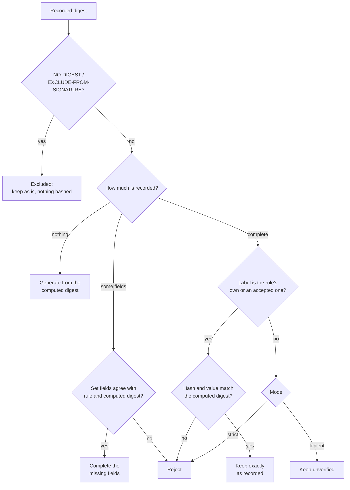

# ADR 0032: Shared Resource Digest Rules

* **Status**: proposed
* **Deciders**: Maintainers
* **Date**: 2026-10-12

**Technical Story**: Resource digests are created, completed and verified separately in every binding, which led to OCI digests being relabelled on upload and breaking signatures; the fix is on main, and its review asked for one shared set of digest rules.

## Context and Problem Statement

A resource digest records three signed fields: the hash algorithm, the normalisation algorithm and the value. The spec defines the hash names SHA-256 and SHA-512, plus `NO-DIGEST` for resources that are excluded from the signature. It defines two normalisations: `genericBlobDigest/v1` describes the bytes of a blob, and `ociArtifactDigest/v1` describes an OCI artifact by the digest of its manifest or index.

Each binding (OCI, Helm, wget, S3, Git, GitHub, transfer, signing) implements these rules on its own. Until the recent fix, v2 labelled every OCI artifact it created as a generic blob, so that label is now on every v2-created OCI resource and is signed. The current situation has the following problems:

1. **Copied decision logic**: the same "generate, complete or verify" logic exists several times in the OCI binding and again, with different rules, in Helm and transfer.
2. **No single answer for hash names**: bindings accept different spellings (`SHA-256`, `sha256`, case variants), and some rewrite complete digests to their own spelling, which changes signed data.
3. **Content kind is guessed repeatedly**: whether content is an OCI artifact or plain bytes is rediscovered at several steps, and the answers can disagree.
4. **Excluded resources are mostly unsupported**: only signing and download verification detect `NO-DIGEST` / `EXCLUDE-FROM-SIGNATURE`. Elsewhere such resources fail to be added, or their marker is silently replaced by a real digest, which breaks the signature.

Two examples show why a single fixed algorithm is not enough.

**One OCI image, two valid labels.** An image added today records the digest of its manifest as `ociArtifactDigest/v1`. The same image added with an earlier v2 release records the same manifest digest, but labelled `genericBlobDigest/v1`, and that label is signed:

```yaml
# added today
digest:
  hashAlgorithm: SHA-256
  normalisationAlgorithm: ociArtifactDigest/v1
  value: 4f1c...   # digest of the image manifest
---
# the same image, added with an earlier v2 release
digest:
  hashAlgorithm: SHA-256
  normalisationAlgorithm: genericBlobDigest/v1
  value: 4f1c...   # the same manifest digest
```

When the second component is transferred, the label must stay as it is, or the signature breaks. It also must not be verified as plain bytes, because hashing the OCI layout archive gives a different value than the manifest digest. The OCI binding therefore has to accept both labels for an artifact, and decide that it holds an artifact from what it resolved, not from the label.

**One resource type, different content.** A Helm chart from an HTTP repository is a `.tgz` file and gets a digest of its bytes. The same chart from an `oci://` repository is an OCI artifact and gets the manifest digest. wget, S3, Git and GitHub always hash bytes, but receive hash names in different spellings, such as `sha256` from S3 checksums. A resource marked `NO-DIGEST` must pass all of these paths untouched. Each binding knows what it computed; the shared rules only decide what to do with the recorded digest.

## Decision Drivers

* **Compatibility**: Every digest accepted today stays accepted, and no recorded digest is ever rewritten.
* **Single source of truth**: One place decides which hash names and normalisations are valid.
* **Layering**: Shared code has no OCI knowledge; each binding owns the meaning of what it computes.
* **House style**: Plain string constants, small pure functions and sentinel errors, no new blob interfaces.
* **Easy review**: Small PRs; only Go API breaks are marked as breaking.

## Considered Options

* **Option 1**: **Shared digest package with binding-supplied rules**
  * *Description*: A new package holds the spec vocabulary and one pure function that compares the recorded digest with what the binding computed, under a rule the binding supplies.
* **Option 2**: **v1-style digester registry**
  * *Description*: Pick a digester from the recorded hash and normalisation labels and the media type, as OCM v1 does.
* **Option 3**: **Consolidate hash names only**
  * *Description*: Share the hash-name parsing and constants, and leave the decision logic in each binding.

Modelling normalisations as typed runtime objects in a scheme was rejected up front: there is no behaviour per normalisation to decode into, and collapsing aliases to a canonical name would invite rewriting recorded labels.

## Decision Outcome

Chosen **Option 1**: "Shared digest package with binding-supplied rules". Option 3 ships as its first step.

**Justification**:

* **One decision function**: Replaces the copied logic and can be tested once against the full set of cases.
* **One hash-name parser**: Answers "which spellings do we accept?" in one place.
* **Safe dispatch**: The rule follows from what was computed, so the historical generic label on OCI artifacts cannot send them down the wrong path.
* **No new registry**: Dispatch per access type already exists through the digest processor plugins.

### Implementation Details

A new package `bindings/go/digest` holds the vocabulary and the decision, and the OCI binding provides its own rules on top of it:

```go
type Rule struct { Normalisation string; Accepted []string }
func Check(recorded *runtime.Digest, computed Computed, rule Rule, mode Mode) (Result, error)
```

`Check` decides what happens to the recorded digest. It never writes anything itself; the binding applies the result:



#### Key Design Decisions

1. **Shared package without OCI knowledge**: `bindings/go/digest` depends only on the runtime and descriptor packages, which a lint rule enforces. Normalisations stay plain strings. OCI rules live in the OCI binding.
2. **Hash names in one place**: `ParseHashAlgorithm` accepts every spelling in use today, ignoring case and dashes. New and completed digests are written in the spec spelling (`SHA-256`, `SHA-512`).
3. **The binding decides the kind**: A binding that resolved an OCI manifest uses the artifact rule; one that hashed bytes uses the blob rule. The recorded label is only validated against that rule and never chooses it.
4. **Existing digests never break**: `Check` either generates a missing digest, completes an incomplete one, or verifies a complete one and keeps it exactly as recorded, including its label and spelling. The artifact rule accepts the historical generic label on OCI artifacts permanently, verified against the manifest, never against archive bytes.
5. **Excluded resources are left alone**: A `NO-DIGEST` / `EXCLUDE-FROM-SIGNATURE` resource is detected first, exactly as signing does today. It is never hashed, completed or changed when adding (including the constructor, before any digest processor runs), getting or transferring a component version.
6. **Strict and lenient modes**: Each entry point keeps today's handling of a complete digest with a foreign label. Processing and upload reject it (strict); packing local blobs keeps it unverified (lenient).
7. **No entry point becomes stricter**: Changes only widen what is accepted, for example spelling variants and SHA-512 where only SHA-256 was accepted.
8. **Behaviour specified by tests**: The detailed rules for each case are specified by table tests in the implementation PRs, and the tests from the earlier fix remain the regression suite.

#### Out of Scope

* Verifying OCI downloads against the recorded digest.
* The digest written when transferring OCI content to non-OCI targets, and by the Helm to OCI conversion. Both currently replace a `NO-DIGEST` marker with a real digest; keeping the marker there needs maintainer agreement.

## Pros and Cons of the Options

### Option 1: Shared Package with Binding-Supplied Rules (Chosen)

* **Pros**: One tested decision with the never-rewrite guarantee in one place, one hash-name parser, no OCI knowledge in shared code, new rules (such as chunked blobs from ADR 0031) are plain values.
* **Cons**: Touches about ten packages; strict and lenient modes coexist by design; external plugins still implement digest processing themselves.

### Option 2: v1-Style Digester Registry

* **Pros**: Open to new normalisations, close to the spec's idea of a digest handler per media type.
* **Cons**: Choosing by the recorded label would treat every existing v2 OCI resource as a blob and break its digest; adds a second registry with global state for only two cases.

### Option 3: Consolidate Hash Names Only

* **Pros**: Small and low risk.
* **Cons**: The copied decision logic and the repeated kind detection remain, so the main review concern is not addressed.

## Next Steps

* Add `bindings/go/digest` with the hash-name parser and formatter, and move signing, download verification, transfer and the per-binding constants to it.
* Introduce `Check`, `Rule` and the modes, and adopt them in the OCI, Helm and transfer bindings.
* Support excluded resources at every entry point, including the constructor.
* Carry the digest kind on the OCI blob instead of rediscovering it (a breaking Go API change in the OCI blob package).
* Agree with maintainers whether the two out-of-scope transfer outputs keep the `NO-DIGEST` marker.
