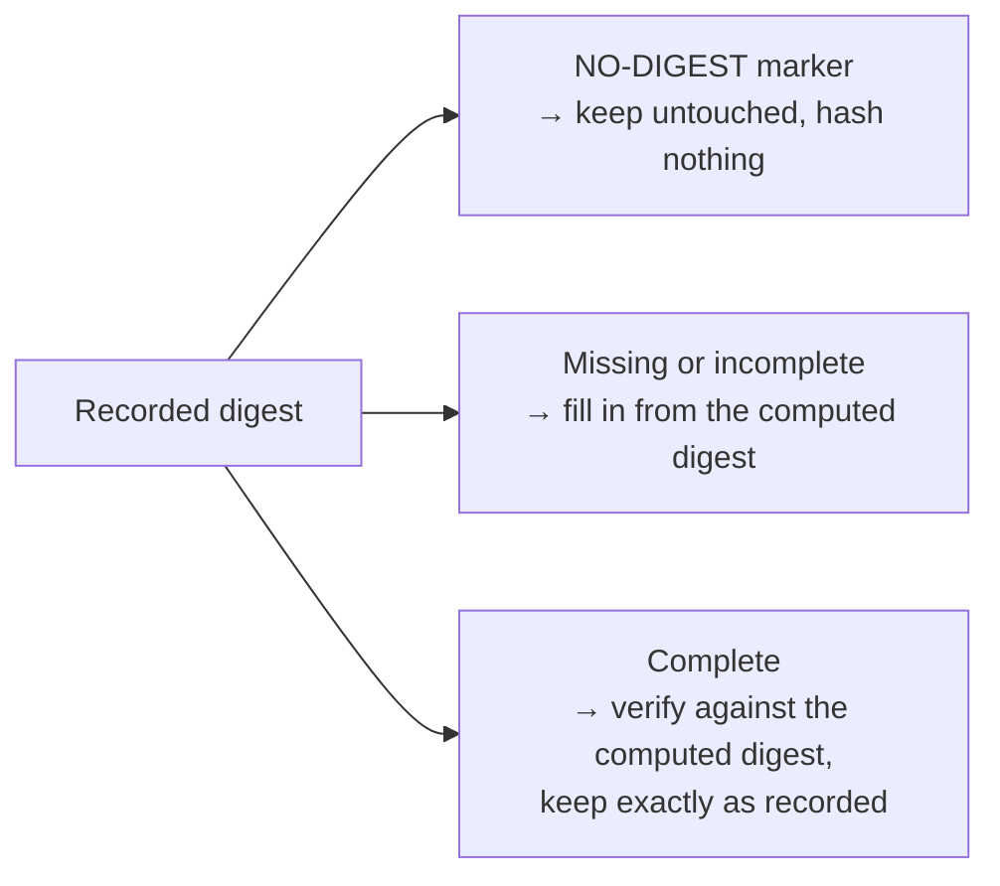

# ADR 0032: Shared Resource Digest Rules

* **Status**: proposed
* **Deciders**: Maintainers
* **Date**: 2026-10-14

**Technical Story**: Resource digests are created, completed and verified separately in every binding, which led to OCI digests being relabelled on upload and breaking signatures; the fix is on main, and its review asked for one shared set of digest rules.

## Context and Problem Statement

A resource digest records three signed fields: the hash algorithm, the normalisation algorithm and the value. The spec defines the hash names SHA-256 and SHA-512, plus `NO-DIGEST` for resources that are excluded from the signature. It defines two normalisations: `genericBlobDigest/v1` describes the bytes of a blob, and `ociArtifactDigest/v1` describes an OCI artifact by the digest of its manifest or index.

Each binding (OCI, Helm, wget, S3, Git, GitHub, transfer, signing) implements these rules on its own. Until the recent fix, a bug made v2 label every OCI artifact it created as a generic blob. That label is now signed on every OCI resource created with those releases, so it must stay valid. The current situation has the following problems:

1. **Copied decision logic**: the same "generate, complete or verify" logic exists several times in the OCI binding and again, with different rules, in Helm and transfer.
2. **No single answer for hash names**: bindings accept different spellings (`SHA-256`, `sha256`, case variants), and some rewrite complete digests to their own spelling, which changes signed data.
3. **Content kind is guessed repeatedly**: whether content is an OCI artifact or plain bytes is rediscovered at several steps, and the answers can disagree.
4. **Excluded resources are mostly unsupported**: only signing and download verification detect `NO-DIGEST` / `EXCLUDE-FROM-SIGNATURE`. Elsewhere such resources fail to be added, or their marker is silently replaced by a real digest, which breaks the signature.

Two examples show why a single fixed algorithm is not enough.

**Same digest fields, different meaning.** An OCI image and a file downloaded with wget both record a SHA-256 digest, but they hash different things:

```yaml
# OCI image: digest of the image manifest
digest:
  hashAlgorithm: SHA-256
  normalisationAlgorithm: ociArtifactDigest/v1
  value: 4f1c...
---
# wget resource: digest of the downloaded bytes
digest:
  hashAlgorithm: SHA-256
  normalisationAlgorithm: genericBlobDigest/v1
  value: 9a07...
```

Only the binding knows which of the two it computed. The OCI binding resolves a manifest, so it must compare against the manifest digest; hashing the OCI layout archive would give a different value. The wget binding hashes the bytes it downloaded.

The OCI case has one more twist. Earlier v2 releases had a bug: they recorded the manifest digest of an OCI image with the `genericBlobDigest/v1` label. Component versions created with those releases are signed with that label, so the OCI binding must keep accepting it, verify it against the manifest digest, and never relabel it. This is why the rule is chosen from what the binding computed, not from the recorded label.

**Same fields, inconsistent handling.** The other bindings show the same pattern:

* **One resource type, two kinds of content**: A Helm chart from an HTTP repository is a `.tgz` file and gets a digest of its bytes. The same chart from an `oci://` repository is an OCI artifact and gets the manifest digest. Only the Helm binding can tell which applies.
* **Hash names spelled differently**: Recorded digests use `SHA-256` as well as `sha256`. Some bindings reject the lowercase form, and some rewrite a complete digest to their own spelling, which changes signed data.
* **Excluded resources**: A resource marked `NO-DIGEST` is rejected or given a real digest by most bindings, although it must pass every path untouched.

Each binding knows what it computed; the shared rules decide, the same way everywhere, what happens to the recorded digest.

## Decision Drivers

* **Compatibility**: Every digest accepted today stays accepted, and no recorded digest is ever rewritten.
* **Single source of truth**: One place decides which hash names and normalisations are valid.
* **Layering**: Shared code has no OCI knowledge; each binding owns the meaning of what it computes.
* **House style**: Plain string constants, small pure functions and sentinel errors, no new blob interfaces.
* **Easy review**: Small PRs; only Go API breaks are marked as breaking.

## Considered Options

* **Option 1**: **Shared digest package with binding-supplied rules**
  * *Description*: A new package holds the spec vocabulary and one pure function that compares the recorded digest with what the binding computed, under a rule the binding supplies.
* **Option 2**: **v1-style digester registry**
  * *Description*: Pick a digester from the recorded hash and normalisation labels and the media type, as OCM v1 does.
* **Option 3**: **Consolidate hash names only**
  * *Description*: Share the hash-name parsing and constants, and leave the decision logic in each binding.

Modelling normalisations as typed runtime objects in a scheme was rejected up front: there is no behaviour per normalisation to decode into, and collapsing aliases to a canonical name would invite rewriting recorded labels.

## Decision Outcome

Chosen **Option 1**: "Shared digest package with binding-supplied rules". Option 3 ships as its first step.

**Justification**:

* **One decision function**: Replaces the copied logic and can be tested once against the full set of cases.
* **One hash-name parser**: Answers "which spellings do we accept?" in one place.
* **Safe dispatch**: The rule follows from what was computed, so the generic label that earlier v2 releases wrote on OCI artifacts by mistake cannot send them down the wrong path.
* **No new registry**: Dispatch per access type already exists through the digest processor plugins.

### Implementation Details

A new package `bindings/go/digest` holds the vocabulary and the decision, and the OCI binding provides its own rules on top of it:

```go
type Rule struct { Normalisation string; Accepted []string }
func Check(recorded *runtime.Digest, computed Computed, rule Rule, mode Mode) (Result, error)
```

`Check` compares the **recorded digest** (what the component descriptor contains) with the **computed digest** (what the binding just resolved or hashed: the manifest digest for an OCI image, the hash of the downloaded bytes for wget). It never writes anything itself; the binding applies the result. There are three cases:



* **NO-DIGEST marker**: The resource is excluded from signing, so nothing is hashed or changed.
* **Missing or incomplete**: Happens while a component version is being built, before it is signed, so filling in the digest cannot break a signature. Fields that are already set must agree with the computed digest; otherwise the digest is rejected. The filled-in digest uses the rule's own label and the spec spelling.
* **Complete**: The digest may be signed, so it is never rewritten. A mismatch is rejected. A label the rule does not know is rejected on add and upload (strict), and kept unverified when packing local blobs (lenient), because existing descriptors may carry it.

#### Key Design Decisions

1. **Shared package without OCI knowledge**: `bindings/go/digest` depends only on the runtime and descriptor packages, which a lint rule enforces. Normalisations stay plain strings. OCI rules live in the OCI binding.
2. **Hash names in one place**: `ParseHashAlgorithm` accepts every spelling in use today, ignoring case and dashes. New and completed digests are written in the spec spelling (`SHA-256`, `SHA-512`).
3. **The binding decides the kind**: A binding that resolved an OCI manifest uses the artifact rule; one that hashed bytes uses the blob rule. The recorded label is only validated against that rule and never chooses it.
4. **Existing digests never break**: `Check` either generates a missing digest, completes an incomplete one, or verifies a complete one and keeps it exactly as recorded, including its label and spelling. The artifact rule keeps accepting the generic label that earlier v2 releases wrote on OCI artifacts by mistake. It also starts accepting `ociArtefactDigest/v1`, a legacy spelling that OCM v1 registers but v2 rejects today. Both are verified against the manifest, never against archive bytes.
5. **Excluded resources are left alone**: A `NO-DIGEST` / `EXCLUDE-FROM-SIGNATURE` resource is detected first, exactly as signing does today. It is never hashed, completed or changed when adding, getting or transferring a component version, except by the two conversions listed under Out of Scope. The constructor skips digest processing for it, and each digest processor also returns early, because the controller calls processors directly.
6. **Strict and lenient modes**: Each entry point keeps today's handling of a complete digest with a foreign label. Processing and upload reject it (strict); packing local blobs keeps it unverified (lenient).
7. **No entry point becomes stricter**: Changes only widen what is accepted, for example spelling variants and SHA-512 where only SHA-256 was accepted.
8. **Behaviour specified by tests**: The detailed rules for each case are specified by table tests in the implementation PRs, and the tests from the earlier fix remain the regression suite.

#### Out of Scope

* Verifying OCI downloads against the recorded digest.
* The digest written when transferring OCI content to non-OCI targets, and by the Helm to OCI conversion. Both currently replace a `NO-DIGEST` marker with a real digest; keeping the marker there needs maintainer agreement.

## Pros and Cons of the Options

### Option 1: Shared Package with Binding-Supplied Rules (Chosen)

* **Pros**: One tested decision with the never-rewrite guarantee in one place, one hash-name parser, no OCI knowledge in shared code, new rules (such as chunked blobs from ADR 0031) are plain values.
* **Cons**: Touches about ten packages; strict and lenient modes coexist by design; external plugins still implement digest processing themselves.

### Option 2: v1-Style Digester Registry

* **Pros**: Open to new normalisations, close to the spec's idea of a digest handler per media type.
* **Cons**: Choosing by the recorded label would treat every existing v2 OCI resource as a blob and break its digest; adds a second registry with global state for only two cases.

### Option 3: Consolidate Hash Names Only

* **Pros**: Small and low risk.
* **Cons**: The copied decision logic and the repeated kind detection remain, so the main review concern is not addressed.

## Next Steps

A proof of concept in [#3907](https://github.com/open-component-model/open-component-model/pull/3907) implements the shared package, the OCI rules, and their adoption in OCI, Helm, signing and the constructor. The regression tests from the earlier fix pass unchanged. The remaining steps:

* Add `bindings/go/digest` with the hash-name parser and formatter, and move signing, download verification, transfer and the per-binding constants to it.
* Introduce `Check`, `Rule` and the modes, and adopt them in the OCI, Helm and transfer bindings.
* Support excluded resources at every entry point, including the constructor.
* Carry the digest kind on the OCI blob instead of rediscovering it (a breaking Go API change in the OCI blob package).
* Agree with maintainers whether the two out-of-scope transfer outputs keep the `NO-DIGEST` marker.
