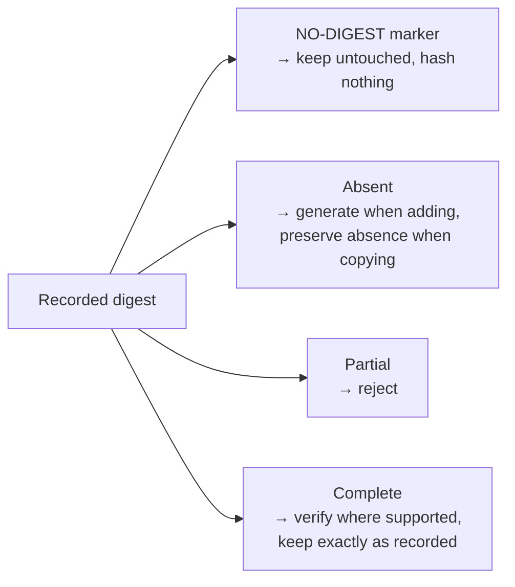

# ADR 0033: Shared Resource Digest Rules

* **Status**: proposed
* **Deciders**: Maintainers
* **Date**: 2026-10-14

**Technical Story**: Inconsistent digest handling across bindings can change signed descriptors. Shared rules are needed to preserve existing digests while allowing bindings to compute digests for different kinds of content.

## Context and Problem Statement

A resource digest records three signed fields: the hash algorithm, the normalisation algorithm and the value. The spec defines the hash names SHA-256 and SHA-512, plus `NO-DIGEST` for resources that are excluded from the signature. It defines two normalisations: `genericBlobDigest/v1` describes the bytes of a blob, and `ociArtifactDigest/v1` describes an OCI artifact by the digest of its manifest or index.

Each binding (OCI, Helm, wget, S3, Git, GitHub, transfer, signing) implements these rules on its own. Until the recent fix, a bug made v2 label every OCI artifact it created as a generic blob. That label is now signed on every OCI resource created with those releases, so it must stay valid. The current situation has the following problems:

1. **Copied decision logic**: the same "generate, complete or verify" logic exists several times in the OCI binding and again, with different rules, in Helm and transfer.
2. **No single answer for hash names**: bindings accept different spellings (`SHA-256`, `sha256`, case variants), and some rewrite complete digests to their own spelling, which changes signed data.
3. **Content kind is guessed repeatedly**: whether content is an OCI artifact or plain bytes is rediscovered at several steps, and the answers can disagree.
4. **Excluded resources are mostly unsupported**: only signing and download verification detect `NO-DIGEST` / `EXCLUDE-FROM-SIGNATURE`. Elsewhere such resources fail to be added, or their marker is silently replaced by a real digest, which breaks the signature.

Two examples show why a single fixed algorithm is not enough.

**Same digest fields, different meaning.** An OCI image and a file downloaded with wget both record a SHA-256 digest, but they hash different things:

```yaml
# OCI image: digest of the image manifest
digest:
  hashAlgorithm: SHA-256
  normalisationAlgorithm: ociArtifactDigest/v1
  value: 4f1c...
---
# wget resource: digest of the downloaded bytes
digest:
  hashAlgorithm: SHA-256
  normalisationAlgorithm: genericBlobDigest/v1
  value: 9a07...
```

Only the binding knows which of the two it computed. The OCI binding resolves a manifest, so it must compare against the manifest digest; hashing the OCI layout archive would give a different value. The wget binding hashes the bytes it downloaded.

The OCI case has one more twist. Earlier v2 releases had a bug: they recorded the manifest digest of an OCI image with the `genericBlobDigest/v1` label. Component versions created with those releases are signed with that label, so the OCI binding must keep accepting it, verify it against the manifest digest, and never relabel it. This is why the rule is chosen from what the binding computed, not from the recorded label.

**Same fields, inconsistent handling.** The other bindings show the same pattern:

* **One resource type, two kinds of content**: A Helm chart from an HTTP repository is a `.tgz` file and gets a digest of its bytes. The same chart from an `oci://` repository is an OCI artifact and gets the manifest digest. Only the Helm binding can tell which applies.
* **Hash names spelled differently**: Recorded digests use `SHA-256` as well as `sha256`. Some bindings reject the lowercase form, and some rewrite a complete digest to their own spelling, which changes signed data.
* **Excluded resources**: A resource marked `NO-DIGEST` is rejected or given a real digest by most bindings, although copying its content unchanged should preserve the marker.

Each binding knows what it computed; the shared rules decide, the same way everywhere, what happens to the recorded digest.

## Decision Drivers

* **Compatibility**: Preserve complete digests and exclusion markers exactly as recorded. Reject partial digests rather than infer fields that may already be covered by a signature or reference digest.
* **Single source of truth**: One place decides which hash names and normalisations are valid.
* **Layering**: Shared code knows no binding (OCI, Helm, Git, wget, ...); each binding owns the meaning of what it computes.
* **Simplicity**: A small shared contract without a second registry or binding-specific dependencies.

## Considered Options

* **Option 1**: **Shared digest package with binding-supplied rules**
  * *Description*: A new package holds the spec vocabulary and one pure function that compares the recorded digest with what the binding computed, under a rule the binding supplies.
* **Option 2**: **v1-style digester registry**
  * *Description*: Pick a digester from the recorded hash and normalisation labels and the media type, as OCM v1 does.
* **Option 3**: **Consolidate hash names only**
  * *Description*: Share the hash-name parsing and constants, and leave the decision logic in each binding.

Modelling normalisations as typed runtime objects in a scheme was rejected up front: there is no behaviour per normalisation to decode into, and collapsing aliases to a canonical name would invite rewriting recorded labels.

## Decision Outcome

Chosen **Option 1**: "Shared digest package with binding-supplied rules".

**Justification**:

* **One decision function**: Replaces the copied logic and can be tested once against the full set of cases.
* **One hash-name parser**: Answers "which spellings do we accept?" in one place.
* **Safe dispatch**: The rule follows from what was computed, so the generic label that earlier v2 releases wrote on OCI artifacts by mistake cannot send them down the wrong path.
* **No new registry**: Dispatch per access type already exists through the digest processor plugins.

### Shared Digest Rules

A shared package compares the **recorded digest** in the component descriptor with the **computed digest** supplied by the binding. Each binding supplies the rules for its content, such as an OCI manifest or downloaded file. There are four cases:



* **NO-DIGEST marker**: The resource content is excluded from signing. Preserve the marker without computing a content digest. Content-converting transfers remain outside this decision.
* **Absent**: Generate a digest when adding a component version, using the binding's normalisation and the spec spelling. A transfer that copies content unchanged preserves the absence of a digest.
* **Partial**: Some fields are set and some are missing. The digest is rejected with "a digest must be complete or absent". Missing fields are never inferred: every digest field is part of the signed descriptor, so filling them in would change what a signature or a parent's reference digest covers.
* **Complete**: The digest may be signed, so it is never rewritten. A mismatch is rejected. A label the rule does not know is rejected on add and upload (strict), and kept unverified when packing local blobs (lenient), because existing descriptors may carry it.

#### Key Design Decisions

1. **Shared package without binding knowledge**: Shared code defines digest handling; each binding supplies the meaning of the content it computed. Adding a binding must not require adding binding-specific logic to the shared package.
2. **Hash names in one place**: Accept existing spellings of supported hash algorithms, ignoring case and dashes. Generate new digests using the spec spelling (`SHA-256`, `SHA-512`).
3. **The binding decides the kind**: A binding that resolved an OCI manifest uses the artifact rule; one that hashed bytes uses the blob rule. The recorded label is only validated against that rule and never chooses it.
4. **Preserve complete digests**: Keep every accepted complete digest exactly as recorded, including its label and spelling. For OCI artifacts, continue accepting the generic label written by earlier v2 releases and add support for OCM v1's legacy spelling `ociArtefactDigest/v1`. Verify both against the manifest, never against archive bytes.
5. **Excluded resources are left alone**: Detect `NO-DIGEST` / `EXCLUDE-FROM-SIGNATURE` before computing content digests. Preserve the marker when adding, getting or transferring a component version, except for the content conversions listed under Out of Scope.
6. **Strict and lenient modes**: Each entry point keeps today's handling of a complete digest with a foreign label. Processing and upload reject it (strict); packing local blobs keeps it unverified (lenient).
7. **Reject partial digests**: A digest must be complete or absent. Rejecting partial digests instead of completing them is a deliberate compatibility change; the shared rules otherwise preserve existing acceptance of complete digests.
8. **Preserve digests on content-preserving transfer**: Keep the source digest, including its absence, unchanged in the target descriptor. Reject partial digests. This prevents changes to a child's descriptor from invalidating a parent's reference digest.

#### Out of Scope

* Verifying OCI downloads against the recorded digest.
* The digest written when transferring OCI content to non-OCI targets, and by the Helm to OCI conversion. Both currently replace a `NO-DIGEST` marker with a real digest; keeping the marker there needs maintainer agreement.

## Pros and Cons of the Options

### Option 1: Shared Package with Binding-Supplied Rules (Chosen)

* **Pros**: One tested decision with the never-rewrite guarantee in one place, one hash-name parser, no binding knowledge in shared code, new rules (such as chunked blobs from ADR 0031) are plain values.
* **Cons**: Requires coordinated adoption across bindings; strict and lenient modes coexist by design; external plugins must adopt the rules too.

### Option 2: v1-Style Digester Registry

* **Pros**: Open to new normalisations, close to the spec's idea of a digest handler per media type.
* **Cons**: Choosing by the recorded label alone would treat OCI resources affected by the earlier labelling bug as plain blobs; adds a second registry alongside existing binding dispatch.

### Option 3: Consolidate Hash Names Only

* **Pros**: Small and low risk.
* **Cons**: The copied decision logic and the repeated kind detection remain, so the main review concern is not addressed.

## Discovery and Distribution

A separate proof of concept explores the shared rules and their adoption in selected bindings. It is not the production rollout. After this decision is accepted:

* Review and productionise the shared contract, then adopt it consistently across bindings and entry points.
* Verify compatibility with existing complete digests and exclusion markers, rejection of partial digests, and preservation of parent reference digests during transfer.
* Document the partial-digest compatibility change and the guarantees for adding and transferring component versions.
* Decide separately how content-converting transfers handle exclusion markers.

## Conclusion

Bindings retain responsibility for computing the digest appropriate to their content. Shared rules make validation and preservation consistent, preventing content-preserving operations from silently changing signed descriptor fields.
