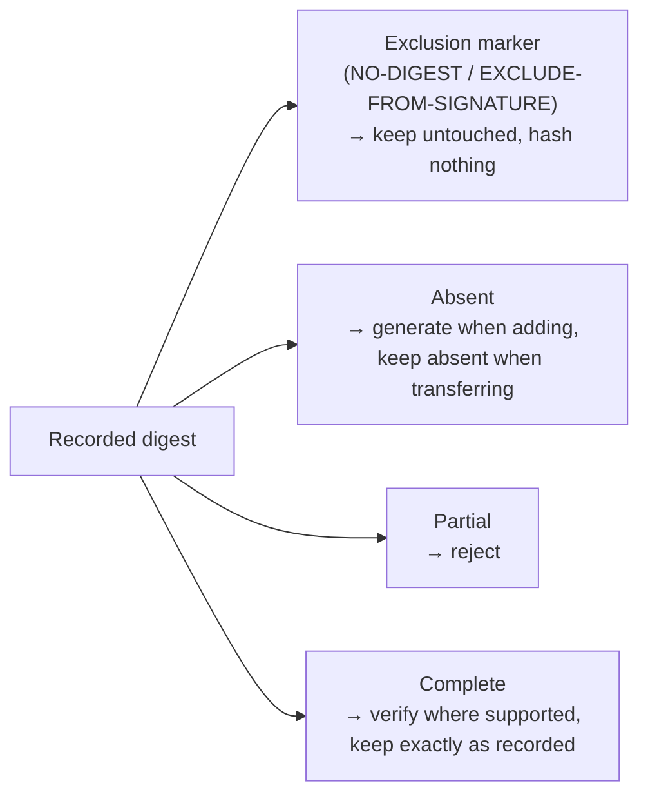

# Shared Resource Digest Rules

* **Status**: proposed
* **Deciders**: Maintainers
* **Date**: 2026-10-14

**Technical Story**: Every binding handles resource digests its own way, so an operation that only copies content can still change a signed descriptor. One shared rule set should keep recorded digests as they are, while each binding keeps computing the digest its own kind of content needs.

## Context and Problem Statement

A resource digest records three signed fields: the hash algorithm, the normalisation algorithm and the value. The spec defines two hash names, SHA-256 and SHA-512, plus `NO-DIGEST` for resources that are excluded from the signature. It defines two normalisations: `genericBlobDigest/v1` for the bytes of a blob, and `ociArtifactDigest/v1` for an OCI artifact, which uses the digest of its manifest or index.

On download, the library already checks the content against the digest the resource records, and one parser reads the hash names a digest may carry. Adding, packing, uploading and transferring have no such rules: each binding (OCI, Helm, wget, S3, Git, GitHub, transfer, signing) decides for itself. Earlier v2 releases also labelled every OCI artifact they created as a generic blob, and that label is part of what those resources signed, so it has to stay valid. Four problems follow:

1. The same "generate, complete or verify" logic exists in the OCI binding's digest package, again in the Helm digest processor and again in transfer, with different rules in each.
2. There is no single answer for hash names. One parser accepts `SHA-256` and `sha256`, ignoring case and dashes, but the digest processors carry their own name tables, and some rewrite a complete digest to their own spelling. That changes signed data.
3. Whether content is an OCI artifact or plain bytes is worked out again at several steps, and the answers can disagree.
4. Only signing and the read path detect `NO-DIGEST` / `EXCLUDE-FROM-SIGNATURE`. When a component version is added, packed, uploaded or transferred, such a resource either fails to be added or has its marker replaced by a real digest, which breaks the signature.

Issue [#3674](https://github.com/open-component-model/open-component-model/issues/3674) shows what this costs a user: `transfer --copy-resources` changed descriptors written by OCM v1, and the ocm-k8s-toolkit then rejected the transferred components with a digest mismatch against their parent's reference digest.

Two examples show why one fixed algorithm cannot cover this.

An OCI image and a file downloaded with wget both record a SHA-256 digest, but they hash different things:

```yaml
# OCI image: digest of the image manifest
digest:
  hashAlgorithm: SHA-256
  normalisationAlgorithm: ociArtifactDigest/v1
  value: 4f1c...
---
# wget resource: digest of the downloaded bytes
digest:
  hashAlgorithm: SHA-256
  normalisationAlgorithm: genericBlobDigest/v1
  value: 9a07...
```

Only the binding knows which of the two it computed. The OCI binding resolves a manifest, so it has to compare against the manifest digest; hashing the OCI layout archive would give a different value. The wget binding hashes the bytes it downloaded.

The OCI case also has to stay compatible with what is already signed. Earlier v2 releases recorded the manifest digest of an OCI image under the `genericBlobDigest/v1` label. Component versions from those releases are signed with that label, so the OCI binding has to keep accepting it, verify it against the manifest digest, and never relabel it. That is why the rule follows what the binding computed, and the recorded label does not pick it.

The other bindings show the same pattern elsewhere:

* A Helm chart from an HTTP repository is a `.tgz` file and gets a digest of its bytes. The same chart from an `oci://` repository is an OCI artifact and gets the manifest digest. Only the Helm binding can tell which case it has.
* Recorded digests spell hash names both ways, `SHA-256` and `sha256`. Some bindings reject the lowercase form, and some rewrite a complete digest to their own spelling, which changes signed data.
* A resource marked `NO-DIGEST` is rejected or given a real digest by most bindings, although copying its content unchanged should keep the marker.

Each binding knows what it computed. The shared rules then decide what happens to the recorded digest, and they decide it the same way everywhere.

## Decision Drivers

* Compatibility: keep complete digests and exclusion markers exactly as recorded, and never fill in a field that a signature or a parent's reference digest may already cover.
* Lenient with what an author writes, strict with what a descriptor records. A digest in a component constructor is completed from what the binding resolved; a digest that is already part of a descriptor is kept untouched or rejected.
* One rule at every point where a recorded digest is written. A transfer is an add on the target repository, so a rule that is relaxed for transfers is relaxed for adding too.
* One place decides which hash names and normalisations are valid.
* Shared code knows no binding (OCI, Helm, Git, wget, ...). Each binding owns the meaning of what it computes.
* A small shared contract, with no second registry and no binding-specific dependencies.

## Considered Options

* Option 1, shared digest package with binding-supplied rules: one pure function in a shared package compares the recorded digest with what the binding computed, under a rule the binding supplies. It reuses the spec vocabulary and the hash-name parser instead of restating them.
* Option 2, v1-style digester registry: pick a digester from the recorded hash and normalisation labels and the media type, as OCM v1 does.
* Option 3, consolidate hash names only: share the hash-name parsing and constants, and leave the decision logic in each binding.

A fourth idea, modelling normalisations as typed runtime objects in a scheme, is ruled out up front: there is no behaviour per normalisation to decode into, and collapsing aliases to one canonical name would invite rewriting recorded labels.

## Decision Outcome

Chosen Option 1: "Shared digest package with binding-supplied rules".

Justification:

* One decision function replaces the copied logic and can be tested once against the full set of cases.
* One parser answers "which spellings do we accept?" for every path, instead of a name table per binding.
* The rule follows from what was computed, so a generic label on an OCI artifact cannot send it down the blob path.
* No new registry is needed, because dispatch per access type already exists through the digest processor plugins.

### Shared Digest Rules

The shared package lives at `bindings/go/digest`, as the proof of concept implements it, next to the other shared vocabulary. It does not go into `bindings/go/signing`: signing is one of its callers, like the bindings, packing and transfer, and a package that signing owns would pull the signing dependency into every binding that computes a digest.

It compares the recorded digest in the component descriptor with the computed digest the binding supplies. The binding also supplies the rule for its kind of content, such as an OCI manifest or a downloaded file. There are four cases:



* **Exclusion marker**: `NO-DIGEST` as the hash algorithm or value, or `EXCLUDE-FROM-SIGNATURE` as the normalisation algorithm. Either field alone marks the resource as excluded, as signing and `repository/integrity` already read it, because a signed descriptor that uses only one of them cannot be corrected without signing it again. The content is excluded from signing, but the marker itself is part of the signed descriptor, so keep it and compute no content digest, including when a transfer converts the content.
* **Absent**: generate a digest when a component version is added, using the binding's normalisation and the spec spelling. A transfer keeps the digest absent, because a parent's reference digest already covers the child descriptor without it.
* **Partial**: the hash algorithm or the value is missing. The digest is rejected with "a digest must be complete or absent". Missing fields are never filled in, because every digest field is part of the signed descriptor, so filling one in would change what a signature or a parent's reference digest covers. A digest an author wrote in a component constructor is a different case, handled before it becomes a recorded digest (see below).
* **Complete**: the digest may be signed, so it is never rewritten. A mismatch is rejected. A label the rule does not know is rejected, because nothing can verify it. An operation that cannot keep the digest valid for the content it produces fails.

A digest that carries a hash algorithm and a value but no normalisation algorithm is complete, and it describes the bytes of a blob. Only the blob rule accepts it, so it can never pass as the digest of an OCI artifact, and the read path already reads it the same way (`classify` in `bindings/go/repository/integrity`). OCM v1 and cc-utils wrote such digests, so rejecting them would strand those component versions.

The four cases apply everywhere a digest is written or checked: adding, packing, uploading, transferring and reading. The read path already works this way; the rules bring the other entry points in line with it, so a resource is handled the same way everywhere.

#### A Digest an Author Writes Is Not a Recorded Digest

A digest in a component constructor is something a person typed, usually to pin content they know the hash of. It belongs to no descriptor yet, nothing signs it, and no parent reference covers it, so a field the author left out can be taken from what the binding resolved without inventing anything. The digest processor of the access type does that while the component version is built: the S3 and GitHub processors fill in the hash and normalisation algorithm, accept any case or dash spelling, and fail only on a genuine conflict, where the author pinned a different hash algorithm, a different normalisation or a different value. That behaviour ships today and stays.

Once the digest is in a descriptor the situation reverses. The descriptor may be signed, a parent's reference digest may cover it, and the content may sit in a registry someone else controls. From then on the four cases apply: the digest is kept exactly as recorded or rejected, and no field is filled in.

The two paths meet in the constructor, which completes author input first and hands a complete digest to the rules. Everything after that point, packing, uploading, transferring and signing, sees only recorded digests.

#### Why Transfer Is Not the Lenient Path

Being lenient about a digest that cannot be verified looks attractive during transfer, since the component version it comes from is already published and a transfer only moves it. The rules still reject, for two reasons.

A transfer writes the component version into the target repository through the same code that adding uses. The transfer copies the recorded digest verbatim (`withSourceDigest` in `bindings/go/transfer/internal`) and the target's add and upload paths are what validate it, so there is no separate transfer check to relax. Accepting a partial or unverifiable digest for transfers means accepting it when adding.

A warning would publish a component version in the target whose digest nothing can check, and the next transfer out of that target would copy it on. The rejection happens while the content is still in hand and the descriptor can still be fixed at its source.

Leniency that costs nothing is the default elsewhere too: exclusion markers pass untouched, an absent digest stays absent, hash names are accepted in any case and dash spelling, the artifact rule accepts the generic label of earlier v2 releases as well as OCM v1's spelling, and an unlabelled digest is accepted as a blob digest. What the rules refuse is only a recorded digest that no rule can verify or that would have to be invented.

#### Design Decisions

1. Shared code defines digest handling, and each binding supplies the meaning of the content it computed. Adding a binding must not add binding-specific logic to the shared package.
2. One parser accepts the existing spellings of the supported hash algorithms, ignoring case and dashes, instead of a name table per binding. New digests use the spec spelling, `SHA-256` or `SHA-512`.
3. The binding decides the kind it resolved. A binding that resolved an OCI manifest uses the artifact rule; one that hashed bytes uses the blob rule. The recorded label is only checked against that rule and never picks it. Where a binding hands over content it has not resolved, such as an archive it only streams, the recorded normalisation decides between hashing the bytes and inspecting the archive as it is read. Even then the label is not rewritten.
4. Every accepted complete digest stays exactly as recorded, including its label and its spelling. The artifact rule accepts three labels: `ociArtifactDigest/v1`, the `genericBlobDigest/v1` written by earlier v2 releases, and OCM v1's spelling `ociArtefactDigest/v1`. All three are verified against the manifest, never against archive bytes.
5. Excluded resources are left alone. The marker is detected before any content digest is computed, and it survives adding, reading and transferring, including a transfer that converts the content, such as a Helm chart into an OCI artifact or an OCI artifact into a file on a non-OCI target.
6. Adding, uploading, packing local blobs, transferring and signing apply the same rules, because they all write a descriptor. A complete digest whose label the binding's rule does not know is rejected.
7. A recorded digest must be complete or absent. A missing hash algorithm or value is never filled in; a missing normalisation algorithm means the bytes of a blob. A digest an author wrote in a component constructor is completed first by the digest processor of its access type, which only reports a conflict when the author pinned something the binding did not resolve.
8. Digests never change on transfer. A transfer copies every digest unchanged into the target descriptor, including its absence and the exclusion marker, and rejects a partial one. A transfer whose target content would need a different digest fails, for example a Helm chart converted into an OCI artifact, or an OCI artifact written as a file on a non-OCI target. The child descriptor therefore never changes, so a parent's reference digest stays valid.

Helm shows how a binding picks the rule. The Helm binding knows whether it resolved a chart from an HTTP repository, where it hashed the `.tgz` bytes, or from an `oci://` repository, where it resolved a manifest, and it supplies the blob rule or the artifact rule accordingly, so one resource type gets the rule that matches the content actually resolved. The recorded label is then only checked against that rule: a chart recorded with `genericBlobDigest/v1` and served from an `oci://` repository is verified against the manifest digest, since the artifact rule accepts that label, and the label stays as recorded. A chart that moves between the two kinds of repository would need a different digest, which is the transfer that fails rather than relabel the resource.

Packing verifies a blob digest against the packed bytes, and an OCI artifact digest against the root manifest of the layout or artifact set, never against the archive bytes. Copying an artifact walks its graph and checks every node against its descriptor digest, so a matching root cannot vouch for substituted layers. A label that neither packing nor downloading can verify is rejected on both paths, rather than kept as a claim nobody can check or replaced by one that would change signed metadata.

#### Out of Scope

* How content is verified on read and download. That path already binds content to the recorded digest: raw bytes are hashed, an OCI artifact is checked against the root it resolves to, and an archive is inspected as it is read, with every node of its graph checked against its descriptor. The four cases above apply to the recorded digest on that path as everywhere else, but these rules do not change those mechanics and do not exempt reads from verification.

## Pros and Cons of the Options

### Option 1: Shared Package with Binding-Supplied Rules (Chosen)

Pros:

* One tested decision, with the never-rewrite guarantee in one place.
* One hash-name parser.
* No binding knowledge in shared code.
* New rules, such as chunked blobs from ADR 0031, are plain values.

Cons:

* Needs coordinated adoption across bindings.
* Descriptors with unknown digest labels are rejected everywhere, including on transfer, so a component version that carries one has to be fixed at its source.
* Converting transfers of resources that carry a digest fail.
* Two paths have to stay aligned, completing author input and checking recorded digests, and only the second one is shared code today.
* External plugins have to adopt the rules too.

### Option 2: v1-Style Digester Registry

Pros:

* Open to new normalisations.
* Close to the spec's idea of a digest handler per media type.

Cons:

* Choosing by the recorded label alone would treat OCI resources that carry a generic label as plain blobs.
* Adds a second registry alongside the existing binding dispatch.

### Option 3: Consolidate Hash Names Only

Pros:

* Small and low risk.

Cons:

* The copied decision logic and the repeated kind detection remain, so the main review concern is not addressed.

## Discovery and Distribution

A proof of concept in [PR #3907](https://github.com/open-component-model/open-component-model/pull/3907) implements the shared rules in `bindings/go/digest` and adopts them in the OCI binding, packing, the Helm digest processor and transfer. It is a proof of concept, not the production rollout, so the work below is still open once this decision is accepted:

* Review and productionise the shared contract, reusing the existing vocabulary and hash-name parser, then adopt it across the remaining bindings and entry points, including external plugins.
* Make the digest processors agree on author input. The S3 and GitHub processors complete a hand-written digest, while the Helm processor passes it straight to the rules and therefore rejects a constructor entry that gives only a value. Completing author input deserves one shared implementation, as checking recorded digests already has.
* Align the read path with the rules where the two differ. `isArtifactNormalisation` in `bindings/go/repository/integrity` accepts an unlabelled digest for an OCI artifact and does not accept OCM v1's `ociArtefactDigest/v1`, while the artifact rule does the opposite in both cases.
* Verify compatibility with existing complete digests and exclusion markers, rejection of partial digests, and preservation of parent reference digests during transfer.
* Document which digests are rejected, partial ones and unknown labels, and the guarantees for adding and transferring component versions.

## Conclusion

Each binding keeps computing the digest that fits its content. The shared rules make validation and preservation the same everywhere, so an operation that only copies content no longer changes signed descriptor fields.
