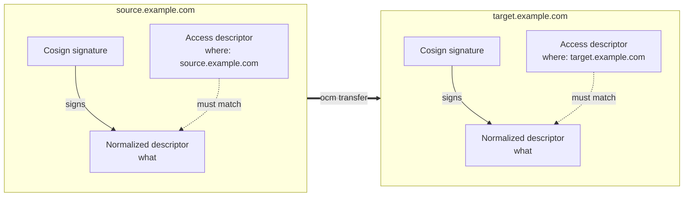
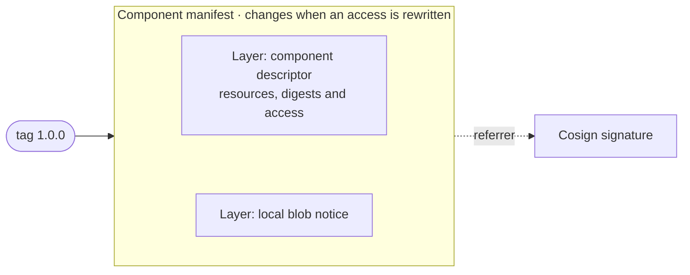
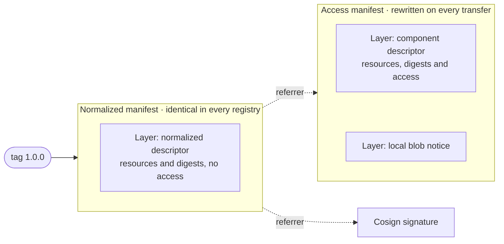

[Cosign](https://docs.sigstore.dev/cosign/signing/overview/) is how most teams sign container images today. An OCM
component version is stored in an OCI registry, just like an image. So it is fair to ask: can we sign a component with
plain cosign, move it to another registry or into an air-gapped environment, and verify it there with plain cosign?

For some components the answer is already yes. In this post we show when it works, why it stops working for most
real-world components, and the idea that makes it work for all of them.

Our example is the component `acme.org/demo` in version `1.0.0`. We move it from the registry `source.example.com`
to the registry `target.example.com`.

## Cosign Signs a Manifest Digest

Cosign does not sign content directly. It signs the digest of an OCI manifest and stores the signature in the same
repository, as a referrer of that manifest. `cosign verify` looks up the signatures for a digest. If a single byte of
the manifest changes, its digest changes, and the signature no longer applies.

For a component version, the version tag points to a manifest that contains the *component descriptor* as a layer. The
descriptor lists the resources of the component, each with its digest and its *access*: the information where the
resource can be fetched. Any change to the descriptor therefore changes the manifest digest.

## It Already Works If Everything Travels Inside the Component

A resource can be stored inside the component version itself. OCM calls this a *local blob*. The access of a local
blob is not a location. It is the digest of the content:

```yaml
name: notice
access:
  type: LocalBlob/v1
  localReference: sha256:bdb3d8b26f5e…
```

When such a component moves to another registry, nothing in the descriptor has to change.

First, we ask the source registry for the manifest digest of our component version:

```console
$ oras resolve source.example.com/component-descriptors/acme.org/demo:1.0.0
sha256:f8e9c0b7e0df…
```

We sign exactly this digest with cosign:

```bash
cosign sign --key cosign.key \
  source.example.com/component-descriptors/acme.org/demo@sha256:f8e9c0b7e0df…
```

Then we transfer the component to the target registry:

```bash
ocm transfer componentversion \
  oci::source.example.com//acme.org/demo:1.0.0 \
  oci::target.example.com
```

The target registry reports the same digest, so the signature is still valid:

```console
$ oras resolve target.example.com/component-descriptors/acme.org/demo:1.0.0
sha256:f8e9c0b7e0df…
```

There is one gap today: `ocm transfer` moves the component, but not the cosign signature stored next to it. We have to
copy the signature ourselves:

```bash
oras cp -r \
  source.example.com/component-descriptors/acme.org/demo@sha256:f8e9c0b7e0df… \
  target.example.com/component-descriptors/acme.org/demo
```

After that, cosign verifies the component in the target registry:

```bash
cosign verify --key cosign.pub \
  target.example.com/component-descriptors/acme.org/demo@sha256:f8e9c0b7e0df…
```

## It Breaks When a Resource Lives Somewhere Else

Most components do not carry everything inside. They point to images where those images already are. Our component
now also has a resource `podinfo`, an image in the source registry:

```yaml
name: podinfo
access:
  type: OCIImage/v1
  imageReference: source.example.com/stefanprodan/podinfo:6.7.1
```

An air-gapped environment cannot reach `source.example.com`. So we let the transfer take the image along. OCM copies
the image to the target registry and rewrites the access to point to the copy:

```yaml
name: podinfo
access:
  type: OCIImage/v1
  imageReference: target.example.com/stefanprodan/podinfo:6.7.1
```

That is exactly what a transfer is for. But the descriptor changed, and with it the manifest digest. The source
registry reports one digest:

```console
$ oras resolve source.example.com/component-descriptors/acme.org/demo:1.0.0
sha256:bdbd2e9a1786…
```

The target registry reports another:

```console
$ oras resolve target.example.com/component-descriptors/acme.org/demo:1.0.0
sha256:6188048b4394…
```

The cosign signature was made for a digest that does not exist in the target. It cannot be verified there.

OCM's own signatures (`ocm sign`) never had this problem, because they ignore locations. But they live inside the
descriptor, where cosign, policy engines and admission controllers cannot see them.

## The Idea: Separate *What* from *Where*

The image did not change when it was moved. Only its location did. So we split the descriptor into two documents:

* The **normalized descriptor** says *what* the component is: its name, its version, its resources and the digest of
  each resource. It contains no locations, so it is identical in every registry. The version tag points to it, and
  this is what cosign signs.
* The **access descriptor** says *where* each resource is in this particular registry. It is written anew on every
  transfer. It is not signed. It is stored as a referrer of the normalized descriptor's manifest.



Is the unsigned part safe? Yes. Every time OCM reads a component, it removes the locations from the access descriptor
and checks that the result is byte for byte the signed, normalized descriptor. Every downloaded resource is checked
against the digest in the signed document. A location may change. What it leads to may not.

## Sign, Transfer, Verify

The new layout is experimental and not merged to `main` yet. On the branch of the
[pull request](https://github.com/open-component-model/open-component-model/pull/3888), we enable it in the OCM
configuration file `ocmconfig.yaml`:

```yaml
type: generic.config.ocm.software/v1
configurations:
  # store component versions as normalized descriptor + access descriptor
  - type: oci.storage.config.ocm.software/v1alpha1
    componentVersionLayout: normalized
  # take referenced images along on transfer
  - type: oci.uploader.transfer.config.ocm.software/v1alpha1
```

We publish the same component as before, with the `podinfo` image in the source registry:

```bash
ocm add componentversion --config ocmconfig.yaml \
  --repository oci::source.example.com \
  --constructor component-constructor.yaml
```

We ask the source registry for the manifest digest:

```console
$ oras resolve source.example.com/component-descriptors/acme.org/demo:1.0.0
sha256:2a6ee1eb95e4…
```

We sign it with cosign, exactly as before:

```bash
cosign sign --key cosign.key \
  source.example.com/component-descriptors/acme.org/demo@sha256:2a6ee1eb95e4…
```

We transfer the component, and the image with it:

```bash
ocm transfer componentversion --config ocmconfig.yaml \
  oci::source.example.com//acme.org/demo:1.0.0 \
  oci::target.example.com
```

The access of `podinfo` was rewritten from `source.example.com` to `target.example.com`, as in the previous section.
This time the target registry still reports the same digest:

```console
$ oras resolve target.example.com/component-descriptors/acme.org/demo:1.0.0
sha256:2a6ee1eb95e4…
```

And `ocm transfer` carried the signature along, so cosign verifies the component in the target registry right away:

```console
$ cosign verify --key cosign.pub \
    target.example.com/component-descriptors/acme.org/demo@sha256:2a6ee1eb95e4…

The following checks were performed on each of these signatures:
  - The cosign claims were validated
  - The signatures were verified against the specified public key
```

No second signature, no signing key in the target environment, no OCM-specific verification tooling. The same works
across a real air gap, with the component carried as a CTF archive in between.

## The Two Storage Formats Compared

This is what the registry stores for our example component, with the local blob `notice` and the image reference
`podinfo`, in both layouts. A dotted arrow leads from a manifest to an OCI referrer of it. The `podinfo` image itself is
stored in its own repository in both cases. The descriptor only references it.

### Current Layout



### Normalized Layout



| | Current layout | Normalized layout |
| --- | --- | --- |
| The version tag points to | the manifest with the full descriptor | the manifest with the normalized descriptor |
| `artifactType` of the tagged manifest | `…component-descriptor.v2` | `…component-descriptor.normalized.v1` |
| Manifest digest after a transfer | changes when an access is rewritten | stays the same |
| Access and local blobs | in the tagged manifest | in the access manifest, a referrer of the tagged manifest |
| Cosign signature after a transfer | not carried by `ocm transfer`, and lost when the digest changed | carried by `ocm transfer`, verifies as is |

## Where We Are

The normalized layout is proposed in
[ADR 0034](https://github.com/open-component-model/open-component-model/pull/3888) and implemented in the same pull
request. The current layout stays the default and is unchanged. Next on our list is verifying cosign signatures
directly inside OCM, so that the CLI and the controllers can enforce them as well.

We are happy about feedback on the pull request or in our
[community channels]().
