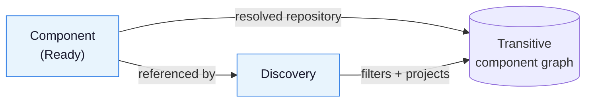

The `Discovery` is a Kubernetes controller that publishes a filtered, 
optionally projected view of the transitive reference graph of a `Component`.
It is a read-only, query-style resource: it downloads no artifacts, creates no
external resources, and provides no signature-verification guarantees for the
descriptors it filters.

For a worked example, see the
[Discover Component Graphs]()
how-to guide.

## What Discovery does

A `Discovery` references a `Component` in the same namespace via
`spec.componentRef.name`. When that `Component` is `Ready`, the controller:

1. Uses the repository resolved in the `Component`'s
   `status.component.repositorySpec` as the traversal base. Resolvers from the
   effective OCM configuration also apply, so references may resolve elsewhere.
2. Resolves the **entire** reachable component graph before filtering or
   publishing anything.
3. Applies the reference, component, and resource selectors.
4. Sorts descriptors lexicographically by `(component.name, component.version)`.
5. Publishes filtered raw v2 descriptors in `status.components`, or projected
   records in `status.extracted` when `spec.extract` is set.




The controller resolves the complete graph even when your selectors target an
exact identity, and the first resolution failure cancels the rest: the last
successful payload is retained and `Ready` goes `False` with reason
`ResolutionFailed`. There is no partial resolution and no identity-based
short-circuiting.


## Selectors

`spec.referenceSelector`, `spec.componentSelector`, and `spec.resourceSelector`
are all optional `Selector` objects. A `Selector` has three clauses, all ANDed
together. A nil or empty selector matches everything.

- **`matchIdentity`** — Matches elements whose [identity]() contains all specified
  key-value pairs. Keys must be present, including comparisons against an empty
  value.
- **`matchLabels`** — Matches elements carrying labels with the specified
  **string** values. Non-string label values are matched via `expression` only.
- **`expression`** — A CEL expression evaluated for each element; it must
  evaluate to a boolean. An empty expression is a no-op.

Selector CEL bindings:

- `identity` — the element identity, a map of string to string. On the
  reference stage it also carries `componentName`, the name of the referenced
  component, alongside the reference's own name, version, and extra identity.
- `labels` — a map from label name to the decoded JSON value of the label.

The stages run in order. The `referenceSelector` scans the references of **all**
resolved descriptors and keeps each target with at least one matching incoming
reference. The `componentSelector` then filters the surviving components.
The `resourceSelector` filters each surviving component's resources **and drops
the component when none of them match**, so selecting by resource selects the
components that carry such a resource.

### semverCheck

Selector and extraction expressions (see below) can call `semverCheck(version, constraint)`,
which returns a boolean using SemVer semantics (SemVer applies only to
`semverCheck`; graph ordering is lexicographic):

```yaml
componentSelector:
  expression: semverCheck(identity.version, ">=2.7.0, <2.10.0")
```

## Extraction

Set exactly one extraction mode under `spec.extract`. `extract: {}` is invalid.

- **`byResources`** (bindings `component`, `resource`, `referencePath`,
  `resourceIdentity`) — Each map value is a CEL expression evaluated once per
  surviving `(component, resource)` pair.
- **`byComponents`** (bindings `component`, `referencePath`) — Each map value is
  a CEL expression evaluated once per surviving component.
- **`expression`** (binding `components`) — A single CEL expression evaluated
  once over the complete filtered descriptor list; must return a list of objects.

Notes:

- Map-mode values use v2 JSON field names (for example `component.name`,
  `resource.access.imageReference`). An explicitly empty map (`byResources: {}`)
  emits one empty record per iteration.
- `expression` mode binds full v2 descriptors (for example
  `components[0].component.componentReferences`) and is strict: it must produce
  objects with string keys.
- All modes must return a list of objects. Anything else fails with
  `ExtractFailed`.

### Addressing a resource with a Resource object

`referencePath` and `resourceIdentity` are computed by the controller so that a
discovered resource can be consumed through a `Resource` object, which verifies
what Discovery does not. Both go verbatim into its `spec.resource.byReference`:

- **`referencePath`** is a list of reference identities leading from the root
  component to the current one, empty for the root. It is computed on the
  unfiltered graph, so a selector that drops an intermediate component does not
  cut it. Where several paths lead to a component, the shortest wins, and among
  equally short paths the lexicographically smallest.
- **`resourceIdentity`** is the identity of the current resource, including its
  `extraIdentity`. Pass it instead of building an identity from
  `resource.name`, which does not match a resource with extra identity.

Both carry `version` only where name and extra identity are not unique among all
references or resources of the component, whatever the selectors keep, in line
with the [identity rules]().
An identity without `version` keeps matching when the root component moves to a
new version; one that keeps its `version` is pinned to it and stops resolving
once that version is gone. Raw mode and `expression` mode do not have these
bindings.

An element that no identity selects on its own, such as one of two references
or resources with equal identities, or a resource without `version` next to a
same-named one with it, gets no binding: like any missing access, the field is
omitted from its record. A `Resource` would resolve such an identity to the
first match, which need not be the element the record describes. A component
reachable only through such a reference has no `referencePath`.

The detour through a `Resource` matters because Discovery publishes whatever the
repository returns when it walks the graph. If a nested component version is
overwritten in the repository, a `Discovery` that walks it afterwards stays
`Ready` and publishes the new content. A `Resource` built from the same record
checks the root component version against the signatures you configure, every
component version on the reference path against the digest its parent records
for the reference, and, unless its `spec.verificationPolicy` is `Never`, the
resource digest, so when it reconciles it fails with `digest mismatch` instead.
Neither watches the repository: both reconcile when the root `Component` reports
a change or their own spec changes. The checks depend on the information being
there: a reference without a recorded digest is not checked, the root is only
checked when signature verification is configured, and a root that cannot be
safely digested skips the signature check with a warning event. `ocm add cv`
records reference digests.

Take access data from the `Resource` status (`status.resource.access`), not from
the `Discovery` status, and only once the `Resource` is `Ready` with
`status.observedGeneration` equal to `metadata.generation`; until then the
status can still describe the previous spec. `status.component` shows the
component version the resource was taken from. The verification holds at the
time of the reconcile: an access that addresses content by digest, such as a
digest-pinned OCI image reference, always yields the verified content, but
others, such as an HTTP URL, a git reference, or an S3 object, can return
different content later. Verify content fetched through those against
`status.resource.digest`.

A record extracted with `referencePath: referencePath` and
`resource: resourceIdentity`, such as

```json
{
  "referencePath": [{ "name": "platform" }, { "name": "podinfo" }],
  "resource": { "architecture": "amd64", "name": "image" }
}
```

becomes this `Resource`, with `componentRef` naming the `Component` the
`Discovery` references:

```yaml
apiVersion: delivery.ocm.software/v1alpha1
kind: Resource
metadata:
  name: podinfo-image-amd64
  namespace: default
spec:
  componentRef:
    name: releasechannel
  resource:
    byReference:
      referencePath:
        - name: platform
        - name: podinfo
      resource:
        name: image
        architecture: amd64
```

### Creating the Resource objects

Each discovered resource you consume needs its own `Resource`, and each one
reconciles and verifies on its own, so select only what you consume. Selecting
narrowly also keeps the `Discovery` status small: every extracted
`referencePath` grows with the nesting depth and counts against the 1MiB limit
(see [Status semantics](#status-semantics)). How you create the `Resource`
objects depends on who consumes the result:

- **`kubectl`** - For a few resources or a one-off, write the manifests, or
  generate them from `status.extracted`, and apply them. When the `Discovery`
  result changes, apply them again and delete the `Resource` objects whose
  record is gone, for example by giving them a dedicated label and applying with
  `kubectl apply --prune`, selecting that label and setting `--prune-allowlist`
  to the `Resource` type. The default allowlist covers only built-in types, so
  without it the `Resource` objects are not pruned, while built-in objects that
  carry the same label are.
- **kro** - A `ResourceGraphDefinition` with a collection (`forEach` over
  `status.extracted`) keeps one `Resource` per record and deletes the `Resource`
  objects of records that disappear. kro needs permission to manage
  `discoveries`, which the [setup guide]()
  does not grant, and it fails the reconciliation when a collection exceeds its
  size limit, 1000 by default.
- **Your own controller** - A controller that reads the `Discovery` status, for
  example to derive configuration from the discovered versions and accesses,
  creates a `Resource` for every access it hands on, waits until it is `Ready`
  for its current generation, and takes the access from the `Resource` status.

### Absent, null, and missing

There are three possible outcomes:

**A missing access** — an absent map key, an absent attribute, an out-of-range
list index — is never an error. In `byResources` and `byComponents` the field is
omitted from the record, and the record is kept even if all its fields disappear.
Within a selector it simply does not match.

**A field that is present but `null`** is the trap. `descriptor/v2` declares
`resources`, `sources` and `componentReferences` without `omitempty`, so a
component with none of them serializes `null` rather than omitting the key:

```yaml
# Stalls the Discovery: size(null) is "no such overload", an ExtractFailed.
byComponents:
  refs: size(component.componentReferences)
```

```yaml
byComponents:
  # single quotes are required
  refs: 'component.componentReferences == null ? 0 : size(component.componentReferences)'
```

`expression` mode is stricter: the same access that `byComponents` silently
drops fails the whole Discovery. Guard every optional read with `has()` (is the
key there at all) **and** `!= null` (is it there but empty) — a key present with
a `null` value passes `has()`:

```yaml
extract:
  expression: |
    components.map(c, {
      "name": c.component.name,
      "refs": has(c.component.componentReferences) && c.component.componentReferences != null
        ? size(c.component.componentReferences) : 0,
    })
```

**An expression returning `null` or `optional.none()`** is not a missing access:
the key is written into the record with an explicit `null` rather than omitted.

## Configuration and repository scope

Discovery uses the shared OCM configuration propagation of the controller chain:

- **No `spec.ocmConfig`:** inherit only parent (`Component`) configuration
  entries marked `Propagate`.
- **Explicit `spec.ocmConfig`:** resolve those entries instead of the implicit
  inheritance.

The effective configuration is published in `status.effectiveOCMConfig` and used
uniformly for the root and all transitive fetches, including any resolvers it
configures.

## Status semantics

The controller publishes at most one of `status.components` or
`status.extracted`; a CEL validation rule rejects both being set. Presence is
meaningful: an **uncomputed** field is **absent**, while a **selected but empty**
result is an empty list (`[]`), never omitted or null.

On success, including when nothing matches, the controller sets `Ready=True`
with reason `Succeeded`, removes `Stalled`/`Reconciling`, and advances
`status.observedGeneration`. An empty result names the selector stage that
matched nothing, reference, component, or resource, in the `Ready` message.

On failure the controller **retains the last successful payload**, even if it
belongs to the previous output mode, and updates only the conditions:

- **`ResolutionFailed`** (`Ready=False`): The graph could not be resolved —
  repository, auth or network failure, an unavailable component version, or a
  repository that returns another component version than the one requested,
  such as a tag that holds a different version. **Retried with backoff**, since the cause is usually transient and a failure
  below the root produces no watch event to recover from.
- **`SelectorFailed`** (`Ready=False`, `Stalled=True`): Selector compilation,
  evaluation or type error, including exhausting the CEL cost budget on a very
  large graph.
- **`ExtractFailed`** (`Ready=False`, `Stalled=True`): The same for extraction,
  plus an output that is not a list of objects.
- **`PayloadTooLarge`** (`Ready=False`, `Stalled=True`): The payload exceeds the
  1MiB limit; refine the selectors or extraction. The size is checked before
  writing, so the oversized candidate never reaches the API server.


`status.observedGeneration` advances only on a successful reconciliation, and a
failed Discovery keeps its last successful payload. So `status.components` /
`status.extracted` may not reflect the current spec even while `Ready` is
`True`. Always gate consumption on `Ready=True` **and**
`status.observedGeneration == metadata.generation`:

- After a spec change, the previous `Ready=True` stands until the new generation
  has been reconciled.
- A suspended object writes no status at all, so it keeps reporting the result
  of the last spec it did reconcile.


## Scheduling

Discovery is watch-driven with no interval. It watches exactly two things: its
own generation, and the referenced `Component`'s resolved info, effective
config, readiness and termination. Every input that can change the *graph* is
watched or version-pinned — references resolve by version, so the graph cannot
change without the `Component`'s resolved version changing.

Configuration sources are deliberately not watched: credentials decide whether
the graph can be fetched, not what it contains. A Discovery that failed on
credentials retries with exponential backoff (up to five minutes between
attempts), so fixing the `Secret` revives it without a spec change, just not
immediately.

`status.observedComponentDigest` skips the walk when the root digest is
unchanged since the last run. It is only recorded when every reference in the
resolved graph has a digest, since one missing digest anywhere breaks the chain.
A generation change on the `Discovery` always forces a full walk regardless.

Suspended and deleting objects exit reconciliation immediately and retain their
existing conditions and payload. Terminally failed (`Stalled=True`) objects are
not requeued.

## Deletion protection

A referencing `Discovery` blocks deletion of its `Component`, the same way a
referencing `Resource` does. Deleting or retargeting the `Discovery` releases the
old `Component`. Discovery creates no external resources, so it carries no
finalizer of its own and sets no owner reference on the `Component`.

## Not supported

- Partial resolution, `UnresolvedReference`, `status.unresolved`, or
  `PartiallyResolved`.
- Identity-based short-circuiting of the traversal.
- Artifact/resource downloads.
- Signature-verification guarantees for the filtered descriptors. Filtered
  descriptors are **not** signature-verification inputs.
- Digest verification of the walked component versions or of resources. Create
  `Resource` objects from the results to verify them, see
  [Creating the Resource objects](#creating-the-resource-objects).
- Multi-root discovery.

## Related Documentation

- [Guides: Discover Component Graphs]() -
  Create a `Discovery` and publish a filtered view of a component graph
- [Concept: Kubernetes Controllers]() -
  How Discovery fits alongside the reconciliation chain
- [Reference: Discovery CRD]() -
  Full field reference for the Discovery resource
