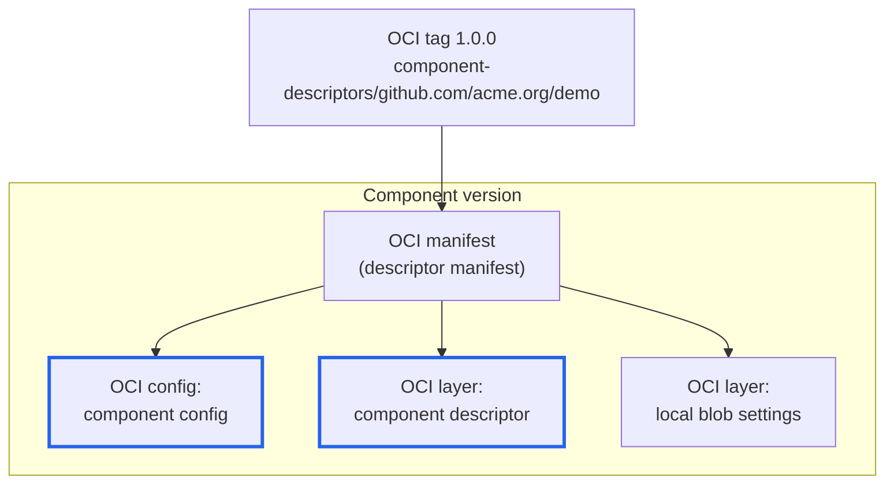
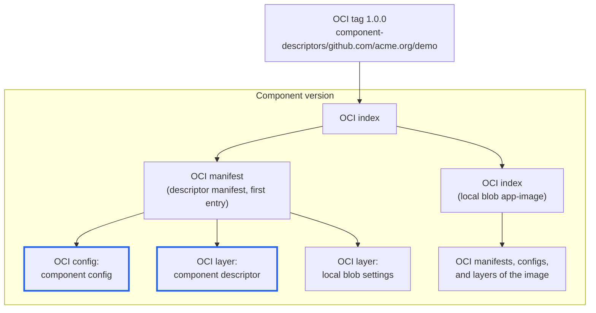

OCM has no storage format of its own. It is designed to store component versions in established content-addressable
storage technologies. Currently, the only supported technology is **[OCI](https://github.com/opencontainers/image-spec)**.

Component versions live in **[OCI registries](https://github.com/opencontainers/distribution-spec/)**, or in a
**Common Transport Format (CTF)** archive, OCM's file system representation of an OCI registry.

This page explains how a component version and its local blobs map to OCI artifacts, what you see in a registry after
`ocm add cv` or `ocm transfer cv`, and why an embedded image can be pulled with `docker`, `oras`, or `crane`.


Other storage technologies, such as object storage like S3, might be supported in the future.




OCM and OCI use some of the same words for different things. This page prefixes OCI terms with *OCI* wherever they
could be confused, and *descriptor* on its own always means the component descriptor.

| Term | Model | Meaning |
| ---- | ----- | ------- |
| Component version | OCM | A versioned component. Stored as one OCI manifest or one OCI index. |
| Component descriptor | OCM | The document that describes a component version: its resources, sources, references, and how to access them. Not an OCI descriptor. |
| Descriptor manifest | OCM on OCI | The OCI manifest that holds the component descriptor and every local blob that is a plain file. |
| Component config | OCM on OCI | The OCI config of the descriptor manifest. Points to the component descriptor layer. |
| Local blob | OCM | A resource or source stored *by value*, next to the component descriptor. Stored as one OCI layer, or as a whole OCI artifact. |
| Artifact (OCM) | OCM | A resource or source of a component version, as in the `software.ocm.artifact` annotation. |
| OCM repository | OCM | Where component versions are stored: an OCI registry plus an optional path, or a CTF archive. Holds many components. |
| OCI repository | OCI | One named repository inside a registry. OCM uses one per component, holding all of its versions. |
| OCI descriptor | OCI | A reference to content by `mediaType`, `digest`, and `size`, as used in a manifest's `config` and `layers`. |
| OCI manifest | OCI | One OCI config plus a list of OCI layers, for example one platform of an image. |
| OCI index | OCI | A list of OCI manifests or further OCI indexes, for example a multi-platform image. The CTF's `artifact-index.json` is not one. |
| OCI layer, OCI config | OCI | The content an OCI manifest references, each addressed by an OCI descriptor. |
| OCI artifact | OCI | An OCI manifest or OCI index together with everything it references. |



## Why Store Component Versions as OCI Artifacts?

- **Reuse existing infrastructure:** Every environment that runs containers already operates an OCI registry, with
  access control, replication, and garbage collection. Storing component versions there means no extra storage
  backend.
- **Content addressing:** OCI identifies every layer, manifest, and index by its digest. OCM uses those digests as the
  `localReference` of a local blob, so storage, deduplication, and integrity checks come for free.
- **Native consumption:** Since OCM v2, OCI artifacts stored by value keep their OCI shape. Tools that know nothing
  about OCM can consume them directly.

## How It Works

A component version is stored as an **OCI artifact** that carries the component descriptor and every resource stored
*by value* (a local blob). It takes one of two forms, depending on the local blobs. OCM picks the form the content
needs, and readers accept both.




Used when no local blob is an OCI artifact. The tag points directly to the **descriptor manifest**: an OCI manifest
whose OCI config is the component config, and whose OCI layers are the component descriptor and one layer per local
blob.



Boxes with a thick blue border hold content that OCM defines. All other boxes are plain OCI objects.



The tag `1.0.0` resolves to this OCI manifest. Digests are shortened, and the `org.opencontainers.image.*` annotations
are left out.

```jsonc
{
  "schemaVersion": 2,
  "mediaType": "application/vnd.oci.image.manifest.v1+json",
  // Marks the OCI manifest as an OCM component version
  "artifactType": "application/vnd.ocm.software.component-descriptor.v2",
  // OCI descriptor of the component config
  "config": {
    "mediaType": "application/vnd.ocm.software.component.config.v1+json",
    "digest": "sha256:207bdf5c…",
    "size": 196
  },
  "layers": [
    // Always first: the component descriptor
    {
      "mediaType": "application/vnd.ocm.software.component-descriptor.v2+json",
      "digest": "sha256:16f96820…",
      "size": 596
    },
    // Local blob "settings": its localReference is this digest
    {
      "mediaType": "text/plain; charset=utf-8",
      "digest": "sha256:5891b5b5…",
      "size": 6,
      "annotations": {
        // The OCM artifact (resource or source) the local blob belongs to
        "software.ocm.artifact": "[{\"identity\":{\"name\":\"settings\",\"version\":\"1.0.0\"},\"kind\":\"resource\"}]"
      }
    }
  ],
  "annotations": {
    "software.ocm.componentversion": "github.com/acme.org/demo:1.0.0"
  }
}
```

The component config holds nothing but the OCI descriptor of the component descriptor layer:

```json
{
  "componentDescriptorLayer": {
    "mediaType": "application/vnd.ocm.software.component-descriptor.v2+json",
    "digest": "sha256:16f96820…",
    "size": 596
  }
}
```






Used as soon as one local blob is an OCI artifact: an image, a Helm chart, or any OCI image layout. The tag points to an
**OCI index**. Its first entry is the descriptor manifest, marked by the artifact type
`application/vnd.ocm.software.component-descriptor.v2`. Every further entry is the OCI manifest or OCI index of an
embedded OCI artifact. Local blobs that are plain files stay OCI layers of the descriptor manifest.



Boxes with a thick blue border hold content that OCM defines. All other boxes are plain OCI objects.



The tag `1.0.0` resolves to this OCI index. Digests are shortened, and the `org.opencontainers.image.*` annotations are
left out.

```jsonc
{
  "schemaVersion": 2,
  "mediaType": "application/vnd.oci.image.index.v1+json",
  "manifests": [
    // Always first: the descriptor manifest (see the Manifest tab),
    // still holding the plain-file local blob "settings" as an OCI layer
    {
      "mediaType": "application/vnd.oci.image.manifest.v1+json",
      "artifactType": "application/vnd.ocm.software.component-descriptor.v2",
      "digest": "sha256:b293e5c8…",
      "size": 1635,
      "annotations": {
        "software.ocm.componentversion": "github.com/acme.org/demo:1.0.0"
      }
    },
    // Local blob "app-image": the original OCI index of the image,
    // its localReference is this digest
    {
      "mediaType": "application/vnd.oci.image.index.v1+json",
      "digest": "sha256:262578cd…",
      "size": 2385,
      "annotations": {
        // The OCM artifact (resource or source) the local blob belongs to
        "software.ocm.artifact": "[{\"identity\":{\"name\":\"app-image\",\"version\":\"6.9.1\"},\"kind\":\"resource\"}]"
      }
    }
  ],
  "annotations": {
    "software.ocm.componentversion": "github.com/acme.org/demo:1.0.0"
  }
}
```

`sha256:262578cd…` is the OCI index of the source image, unchanged. It lists the OCI manifests for `linux/amd64`,
`linux/arm/v7`, and `linux/arm64` and their build attestations. Each of those references its own OCI config and OCI
layers.






In both forms, the component descriptor points to a local blob the same way: `localReference` is the digest of the OCI
layer, OCI manifest, or OCI index that holds the content.

### Repository and Version Mapping

An OCM repository in an OCI registry is a registry plus an optional path, for example `ghcr.io/acme/ocm` (`baseUrl` and
`subPath` of an `OCIRepository/v1`). Each component gets its own OCI repository below that path, and each component
version is a tag in it:

```text
<registry>/<subPath>/component-descriptors/<component-name>:<version>
```

For example, `github.com/acme.org/demo` in version `1.0.0` in `ghcr.io/acme/ocm` is stored at
`ghcr.io/acme/ocm/component-descriptors/github.com/acme.org/demo:1.0.0`. All versions of a component, and all local
blobs of those versions, live in this one OCI repository.

### Two Shapes of Local Blob

How OCM stores a local blob depends on its content:

| Content | Stored as | `localReference` is the digest of | `mediaType` in the access |
| ------- | --------- | --------------------------------- | ------------------------- |
| Plain file, directory archive, Git snapshot, … | An OCI layer of the descriptor manifest | the OCI layer | the content's media type, e.g. `text/plain` |
| OCI artifact: an OCI image layout added with `File/v1`, a chart added with `Helm/v1`, or an image copied by value during transfer | Its full graph of OCI manifests and OCI indexes, unpacked into the OCI repository | the root OCI manifest or OCI index | `application/vnd.oci.image.index.v1+json` or `…manifest.v1+json` |

For OCI artifacts, OCM does not keep the layout archive. It ingests the whole graph — root OCI index, OCI manifests per
platform, OCI configs, and OCI layers — so the stored image is byte-for-byte the original image with the original
digest. Every stored local blob also carries a `software.ocm.artifact` annotation that names the OCM artifact, the
resource or source, it belongs to.

The component descriptor that results from this lists both local blobs like this:

```yaml
resources:
  - name: settings
    type: blob
    access:
      type: LocalBlob/v1
      localReference: sha256:5891b5b5…   # an OCI layer of the descriptor manifest
      mediaType: text/plain; charset=utf-8
  - name: app-image
    type: ociImage
    access:
      type: LocalBlob/v1
      localReference: sha256:262578cd…   # an OCI index, listed in the component version's OCI index
      mediaType: application/vnd.oci.image.index.v1+json
```

### Native Access to Embedded Images

Because `app-image` is a real OCI index in the component's OCI repository, its digest is a valid OCI reference:

```text
ghcr.io/acme/ocm/component-descriptors/github.com/acme.org/demo@sha256:262578cd…
```

Any OCI client can pull it, and a Kubernetes Pod can use it as `image:` directly. Downloading it with
`ocm download resource` instead rebuilds an OCI image layout from the stored graph.

### Storage in a CTF Archive

The CTF is not an OCI standard. OCM defines it so that component versions can travel without a registry, as a
directory or a TAR archive, for example into an air-gapped environment. It is also not an OCI image layout: instead of
`index.json` and `oci-layout`, it has its own `artifact-index.json` that maps OCI repositories and tags to digests, the
way a registry does. Despite its name, `artifact-index.json` is not an OCI index. The blobs the CTF stores are the same
OCI manifests, OCI indexes, OCI configs, and OCI layers as in a registry:

```text
transport-archive/
├── artifact-index.json          # OCI repository + tag → digest, like a registry's tag list
└── blobs/
    ├── sha256.e940ef51…         # OCI index of the component version (tag 1.0.0)
    ├── sha256.b293e5c8…         # descriptor manifest
    ├── sha256.58d34857…         # component config
    ├── sha256.e9a6352b…         # component descriptor
    ├── sha256.5891b5b5…         # local blob "settings" (OCI layer)
    ├── sha256.262578cd…         # local blob "app-image" (OCI index)
    └── …                        # OCI manifests, configs, and layers of the image
```

`artifact-index.json` lists every OCI manifest and OCI index with its OCI repository, and the tag for the component
version itself. Because the content is identical, transferring a CTF to a registry copies the graph and keeps every
digest, including `localReference` values and the digests signatures cover.

## OCM v1 and OCM v2

The graph above is the OCM v2 format. OCM v1 stored component versions differently, and the difference matters when
you work with existing content.

| | OCM v1 | OCM v2 |
| - | ------ | ------ |
| Component version | Always a single OCI manifest | An OCI manifest, or an OCI index once it embeds OCI artifacts |
| Embedded OCI artifact | Packed into an **artifact set** — a `.tar.gz` of the image — stored as one opaque OCI layer | Unpacked into a native graph of OCI manifests and OCI indexes |
| Local blob media type | `application/vnd.oci.image.manifest.v1+tar+gzip` (or `…index.v1+tar+gzip`) | `application/vnd.oci.image.manifest.v1+json` (or `…index.v1+json`) |
| `localReference` | Digest of the archive | Digest of the image's root OCI manifest or OCI index |
| Pull with `docker`/`oras`/`crane` or reference from a Pod | Not possible: the registry sees an archive, not an image | Possible by digest |

OCM v2 still reads OCM v1 content. A v1 artifact set remains an OCI layer when it is copied by value, because unpacking
it would change its `localReference` and the digests a signature covers. To make such an image pullable, upload it as
a standalone OCI image with an OCI uploader during transfer.

In the other direction, the OCM v1 CLI reads local blobs stored in the v2 format starting with v0.36.0. Older v1
releases cannot access them.

## Key Properties

| Property | Description |
| -------- | ----------- |
| **OCI-native** | A component version is a plain OCI artifact; any conformant registry stores it, and any OCI tool can inspect it. |
| **One graph, two backends** | Registries and CTF archives hold the identical graph, so moving between them preserves every digest. |
| **Content-addressed local blobs** | `localReference` is the digest of the stored OCI layer, OCI manifest, or OCI index — stable across OCM repositories. |
| **Self-contained** | All local blobs live in the component's own OCI repository, next to the component descriptor that references them. |
| **Native artifacts stay native** | OCI artifacts stored by value keep their structure and digest and are pullable by digest. |

## Relationship to Other Concepts

- **[Transfer and Transport]()** — Transfer with a local blob uploader
  converts external OCI references into local blobs in this format.
- **[Resource Repositories]()** — Resources stored *by reference*
  stay in external repositories; this page covers what is stored *by value*.
- **[Signing and Verification]()** — Resource
  digests and `localReference` values are content addresses in this graph, which is why a faithful copy keeps
  signatures valid.
- **[Component Identity]()** — The component name and version
  determine the OCI repository and tag.

## When This Matters

- You inspect a registry or CTF archive and want to understand the OCI manifests, OCI indexes, and tags you see.
- You want to deploy an image embedded in a component version without the OCM CLI, e.g. from a Pod spec.
- You migrate from OCM v1 and need to know why older embedded images are not pullable.
- You can ignore the details if you only use OCM commands to add, transfer, and download component versions.


A local blob is not a hidden OCM format. In OCM v2, it is a regular OCI layer or a regular OCI image in the component's
OCI repository, addressed by its digest.


## Next Steps

- [Guide: Add OCI Artifacts]() — Embed OCI images in a component version
- [Guide: Pull OCI Artifacts Natively]() — Pull embedded images with `docker`, `oras`, or `crane`
- [Guide: Upload OCI Images]() — Store embedded images as standalone OCI artifacts instead

## Related Documentation

- [Reference: Input and Access Types]() — `LocalBlob/v1` and other access types
- [OCI Image Format Specification](https://github.com/opencontainers/image-spec) — Manifests, indexes, layers, and image layouts
- [OCI Distribution Specification](https://github.com/opencontainers/distribution-spec) — How registries store and serve them
- [OCM Specification: OCI Registries](https://github.com/open-component-model/ocm-spec/blob/main/doc/04-extensions/03-storage-backends/oci.md) — Normative mapping of component versions to OCI
- [OCM Specification: Common Transport Format](https://github.com/open-component-model/ocm-spec/blob/main/doc/04-extensions/03-storage-backends/ctf.md) — Normative definition of the CTF format
