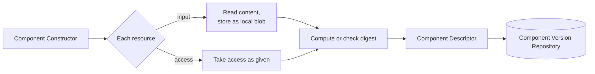

OCM uses two YAML formats that look alike but serve different ends. A component constructor is the editable file you
write to say what a component version should contain. A component descriptor is the final record of a component
version: OCM stores it, signs it, and transfers it. Construction (`ocm add cv`) turns the first into the second.

## Why Two Formats?

The constructor states intent; the descriptor is a record.

- **The author knows files and URLs.** When you build a component, you point to a local file, a directory, a Helm
  chart, or an image that already exists in a registry. You do not know where OCM will store the content, and you
  should not have to compute digests by hand.
- **The consumer needs exact locations and digests.** Whoever downloads, verifies, or deploys a component version
  needs to know where each resource lives and which content to expect. A file path on the author's machine means
  nothing to them.
- **A signature needs content that does not change.** A signature covers the normalised form of the descriptor: the
  name, version, and provider, the resources and sources except their `access`, including the resource digests, the
  component references, and the labels marked `signing: true`. Only resources carry a digest, so a signature does not
  protect the content of a source. This signed content is immutable once stored; changing it would break the signature.
  Other fields can change without breaking it: a transfer can rewrite each `access` to point to the new location, labels
  without `signing: true` can change, and signing adds signatures to the stored descriptor. The constructor, in
  contrast, you can edit as often as you like.

## How Construction Works



Construction processes every resource of a component and writes the result into a descriptor. The descriptor is then
stored in the target component version repository, for example an OCI registry or a CTF archive.

A constructor resource carries either `input` or `access`. An `input` is content that construction adds to the
component version, such as a file (`File/v1`), a directory, a Helm chart, or a download from a URL (`Wget/v1`). An
`access` is a reference to an artifact that already exists, such as an OCI image or an HTTP URL. A descriptor resource carries only `access`: after construction, every
resource is a reference, either to a local blob or to an external artifact.

For an `input`, OCM reads the content and stores it as a local blob next to the component version. The descriptor
records a `LocalBlob/v1` access and the digest of the content. The relation defaults to `local`, and the resource
version defaults to the component version.

For an `access`, OCM takes the access over as given. The relation defaults to `external`. The resource `version` has no
default here: the constructor schema requires it on every `access` resource. OCM computes the digest when it has a
digest processor for the access type.
For an access type without a digest processor, OCM records the resource without checking it and logs a warning: a
digest you set is kept as written, and an unset digest stays empty.

A `digest` in the constructor is optional. When you set it and OCM can compute the digest of the content, construction
checks the two and fails on a mismatch. For an input or an access type with a digest processor, a digest therefore
works as a pin: you state which content you expect, and OCM makes sure it gets that content. For any other access
type, OCM records the digest but does not check it.

Some fields steer construction but do not reach the descriptor. Per-resource `options`, such as the ownership policy,
affect how construction handles a resource and are then dropped.

Component references get the digest of the referenced component descriptor. This binds the referenced component
version to the referencing one, so a signature over the parent also covers its children.

One constructor file can define several components in a `components:` list. Each component yields one descriptor.

Some choices are not part of the constructor file at all. They are options of the construction run:

- **Copy policy** for referenced component versions that are not defined in the constructor file
  (`--external-component-version-copy-policy`): `skip` leaves them where they are; `copy-or-fail` copies them into the
  target repository and fails if a copy fails.
- **Conflict policy** for a component version that already exists in the target repository: replace it (the default),
  abort, or skip. The `--component-version-conflict-policy` flag is deprecated; protect existing versions with
  registry tag immutability instead.

Here is one resource as you write it in the constructor:

```yaml
resources:
  - name: mylocalfile
    type: blob
    input:
      type: File/v1
      path: ./my-local-resource.txt
```

And here is the same resource in the descriptor after construction:

```yaml
resources:
  - name: mylocalfile
    type: blob
    relation: local
    version: 1.0.0
    access:
      type: LocalBlob/v1
      localReference: sha256:70a2577d7b649574cbbba99a2f2ebdf27904a4abf80c9729923ee67ea8d2d9d8
      mediaType: text/plain; charset=utf-8
    digest:
      hashAlgorithm: SHA-256
      normalisationAlgorithm: genericBlobDigest/v1
      value: 70a2577d7b649574cbbba99a2f2ebdf27904a4abf80c9729923ee67ea8d2d9d8
```

The file path is gone. In its place are a storage location, a media type, a relation, a version, and a digest.

## Side by Side

| Aspect | Constructor | Descriptor |
| ------ | ----------- | ---------- |
| **Purpose** | States what a component version should contain | Records what a component version contains |
| **Who writes it** | You, by hand or with a script | OCM, during construction |
| **Mutability** | Editable at any time | Signed content fixed; `access` may change on transfer |
| **Resource content** | `input` or `access` | `access` only |
| **Digests** | Optional; checked when set and OCM can compute it | Recorded when OCM computes it or you set it |
| **Construction directives** | `options`, for example the ownership policy | None |
| **Signatures** | None | Can carry one or more signatures |
| **Where it lives** | Your source tree | A component version repository |

## Relationship to Other Concepts

- **[Component Identity]()**: the name and version you set in the
  constructor become the identity of the component version in the descriptor.
- **[Resource Repositories]()**: an `access` in the descriptor
  points into a resource repository, where the resource content lives.
- **[Signing and Verification]()**: signatures cover
  the descriptor, never the constructor. The digests construction records are what a signature binds.
- **[Transfer]()**: transfer moves descriptors and, if configured,
  their resources between repositories. The constructor plays no part.
- **[Ownership]()**: the ownership policy is a constructor option that
  construction applies to a resource; it is not written to the descriptor.

## What's Next?

- [Getting Started: Create a Component Version]()
- [Guide: Add Component References]()

## Related Documentation

- [Reference: Component Constructor]()
- [Reference: Input and Access Types]()
