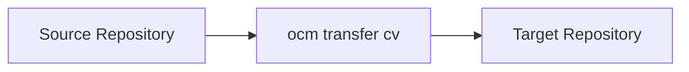
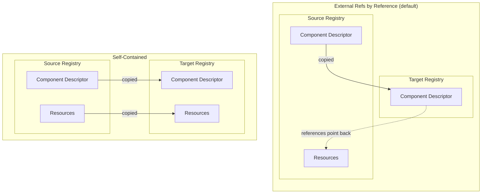
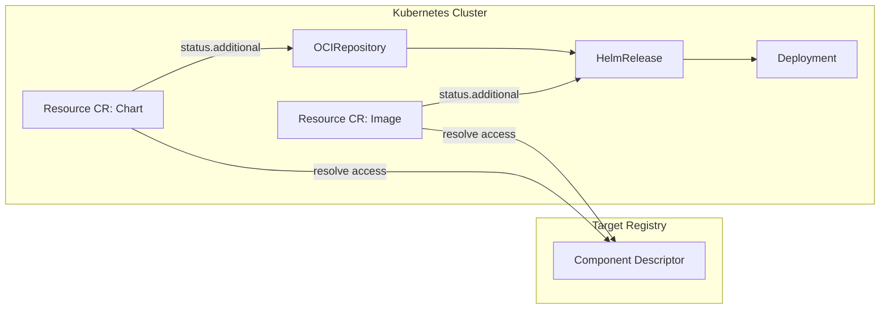
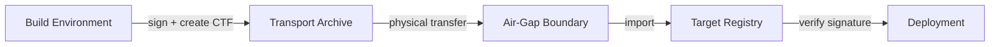

Transfer is the mechanism that moves component versions from one OCM repository to another. During transfer, the component's identity, integrity, and signatures are preserved so that consumers can verify provenance at every stage of the delivery pipeline.

## Why Transfer Matters

Software moves through environments: from development registries to staging, from staging to production, and sometimes across network boundaries where no direct connection exists. At every boundary, artifacts must remain verifiable. Transfer solves this by providing a consistent, auditable way to move component versions while keeping all metadata intact.

For a high-level view of how this enables air-gapped and multi-environment delivery, see [Deploy Anywhere, Even Air-Gapped](#deploy-anywhere-even-air-gapped).

## The Transfer Model

Transfer operates on a simple source/target concept. Any OCM repository can serve as a source or target, whether it is an OCI registry or a filesystem-based CTF archive. The `ocm transfer` command reads component versions from the source and writes them to the target.

Because both OCI registries and CTF archives implement the OCM repository interface, any combination of source and target is valid.

## Common Transport Format (CTF)

The Common Transport Format (CTF) is a filesystem-based OCM repository. It stores component versions as OCI-compatible artifacts in a directory structure, making them portable via any file transfer mechanism: USB drives, `scp`, shared storage, or even physical media.

A CTF archive is a full OCM repository. You can create component versions directly into a CTF, transfer between CTFs, or use a CTF as a staging area between registries.

For details on CTF structure and how to create component versions in a CTF archive, see [Create and Examine Component Versions]().

## Resource Handling: References vs. Copies

By default, `ocm transfer` always copies local blobs — content that was embedded in the component version during `ocm add` or a prior transfer — by value. Resource artifacts that are external references (such as OCI images or Helm charts accessed by their original registry coordinates) stay at their original location; the component descriptor references them by their original access coordinates.

With a local blob uploader configuration (a `localblob.uploader.transfer.config.ocm.software/v1alpha1` entry in your OCM configuration, for example `.ocmconfig` in the working directory), transfer also pulls external-reference resources and uploads them to the target, creating a fully self-contained copy. This is essential for air-gapped scenarios where the target environment cannot reach the original artifact locations.

Use a local blob uploader configuration when:

- The target environment has no network access to the source
- You want a fully independent copy of all artifacts
- You are preparing a CTF archive for offline transport

### Git Repository Snapshots

Resources with `Git/v1` access reference a snapshot of a Git repository. With a local blob uploader configuration, transfer downloads the pinned commit as a gzip-compressed tar archive (`application/x-tgz`) and stores it as a `localBlob` in the target OCI repository or CTF. The resource digest is preserved, and the target no longer needs access to the original Git repository.

By-value Git transfer requires a full commit hash in the access specification. This prevents a moving branch or tag from changing the transferred content. When creating a component version, Git digest processing resolves ref-only access to a pinned commit; if both `ref` and `commit` are present, the commit takes precedence.

Without a local blob uploader, external Git access remains a reference to the original repository. A constructor resource using the `git` input type is already stored as a local blob and follows normal local-blob transfer behavior. Transfer does not push commits or upload content to Git repositories.

## Localization

When resources are copied with a local blob uploader, the component descriptor access coordinates are updated to point to the target registry. However, deployment instructions **embedded inside** resources are not modified. For example, a Helm chart's `values.yaml` may still reference `registry-a.example.com/app:1.0` even after the image has been copied to the target registry. Resources are transferred byte-for-byte to preserve digest integrity, so these internal references remain unchanged.

**Localization** solves this at deploy time, not at transfer time. In a Kubernetes environment, the OCM controller's Resource CR resolves the actual artifact location from the component descriptor and publishes it in its status. Deployment tools like kro or Flux then consume that published location instead of the stale reference embedded in the deployment manifest.

This separation is intentional: transfer preserves artifact integrity, while localization adapts references for the target environment at the point of consumption.

## Transfer Patterns

OCM supports several transfer patterns, depending on your infrastructure:

- **Registry to Registry** -- Direct transfer between two OCI registries. Useful for mirroring between environments that have network connectivity.
- **Registry to CTF** -- Export component versions from a registry into a portable archive. Use this to prepare artifacts for offline transport.
- **CTF to Registry** -- Import component versions from an archive into a registry. This is the final step when bringing artifacts into an air-gapped environment.
- **CTF to CTF** -- Copy component versions between archives. Useful for filtering or reorganizing artifacts before transport.

## Signatures Across Boundaries

OCM component versions can carry two kinds of signatures, and transfer preserves both:

- **OCM signatures** are created with `ocm sign` and stored inside the component descriptor, in its `signatures` list. They travel with the descriptor through every repository type.
- **Cosign signatures** (and other OCI referrers such as attestations) are created with standard OCI tooling like `cosign sign` and are stored next to the component version as OCI referrers. They survive transfer only for component versions stored in the *normalized* OCI layout, described below.

Both kinds of signature cover the same content: the normalized component descriptor, which excludes all `access` information (see [Normalization and Digest Calculation](#normalization-and-digest-calculation)). An OCM signature signs its digest directly; a cosign signature signs the normalized manifest, whose only layer is that normalized descriptor. This is why a signature made in one environment verifies in another, even across an air gap.

### Signatures in the Component Descriptor

OCM signatures are part of the component descriptor and travel with it during transfer.

A typical sovereign delivery flow:

1. The build environment signs the component version and exports it to a CTF archive with a local blob uploader configuration
2. The archive is physically moved across the air-gap boundary
3. The archive is imported into the target registry
4. Before deployment, the signature is verified using the public key

At no point does an OCM signature leave the component descriptor. The verification in the target environment uses the same public key and produces the same result as if verified against the original source.

### Signatures as OCI Referrers (Normalized Layout)

In the default (`v2`) OCI layout, the version tag of a component version points to an OCI manifest that contains the full descriptor, including `access` information and repository-specific annotations. That manifest changes whenever the component version is written to another registry, so a cosign signature over it does not survive transfer.

The **normalized layout** is an opt-in storage layout for OCI registries and CTF archives in which the version tag points to a manifest that contains only the normalized descriptor. Its digest depends only on what the component version contains, not on where it is stored, so it is identical in every registry. You can sign it with `cosign sign` exactly like a container image, and cosign attaches the signature as an OCI referrer. The access information and the local blobs live in a separate, unsigned *access referrer* that OCM regenerates for each registry and checks against the signed manifest before it trusts it.

When a component version is transferred into the normalized layout, `ocm transfer`:

1. writes the same normalized manifest, with the same digest, to the target;
2. writes a new access referrer for the target;
3. copies the OCI referrers of the source manifest, such as cosign signatures and attestations, to the target in a separate step of the transfer.

The signature therefore verifies on the target with no re-signing. If copying the referrers fails, the transfer fails, so a transfer into the normalized layout never silently drops a signature.

The target layout is chosen in this order:

1. the `componentVersionLayout` field of the [transfer configuration](), which `ocm transfer component-version --layout` also sets;
2. the `componentVersionLayout` field of the target repository specification;
3. the layout of the source component version, so a normalized component version stays normalized.

Otherwise the default `v2` layout is used. Commands that rewrite a component version in place, such as `ocm sign`, keep its layout.

Cosign signatures are only carried between repositories that track referrers in the same way, because that setting is part of the normalized manifest. Signatures that cosign stores only under its legacy `sha256-<digest>.sig` tag scheme are not carried; use cosign's OCI 1.1 referrer support.

## Real-World Example

The [sovereign conformance scenario](https://github.com/open-component-model/open-component-model/tree/main/conformance/scenarios/sovereign) demonstrates this complete flow end-to-end. It builds a product as OCM components, signs them, transfers them through a simulated air gap using CTF archives, imports them into an isolated cluster registry, and deploys them using OCM controllers. This scenario validates that signatures, resources, and references survive the entire journey intact.

## Next Steps

- [Getting Started: Create and Examine Component Versions]() - Create component versions and store them in CTF archives
- [Guides: Transfer Components Across an Air Gap]() - Step-by-step guide for air-gapped transfer workflows

## Related Documentation

- [Guides: Signing and Verification]() - Sign and verify component versions
- [Guides: Working with OCI]() - Embed OCI images and access them natively after transfer
- [Concept: OCM Controllers]() - Kubernetes controllers for deploying and transferring OCM components
- [Reference: Transfer Configuration]() - Configure transfer settings and custom uploaders
- [Guides: Configure Custom Uploads During Transfer]() - Route resources to a custom upload target during transfer
