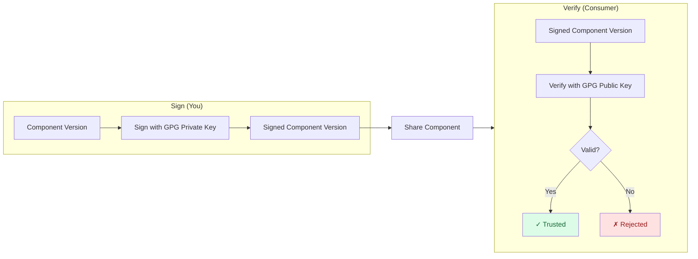

In this tutorial, you'll sign a component version with a GPG private key and verify it with the corresponding public key.
By the end, you'll understand how to use OpenPGP (GPG) signatures with OCM for component authenticity and integrity.

## What You'll Learn

- Create a GPG key pair for signing and verification
- Export ASCII-armored public and private keys
- Configure OCM credentials for GPG signing
- Sign a component version in a CTF archive
- Verify the GPG signature

**Estimated time:** ~15 minutes

## Scenario

You're a software engineer who manages components and uses GPG keys (the same keys used for signing Git commits or releases) to sign OCM component versions.
This lets consumers verify that:

1. **The component is authentic** — it comes from you, not an imposter
2. **The component has integrity** — it hasn't been tampered with since signing

## How It Works



The producer signs the component version with a GPG private key, creating an ASCII-armored OpenPGP detached signature.
Consumers verify using the corresponding public key to confirm authenticity and integrity.

## Prerequisites

- [OCM CLI installed]()
- [GnuPG](https://gnupg.org/download/) installed (`gpg` binary available in `$PATH`), to generate keys and export them. OCM performs all GPG signing and verification in-process; `gpg` is only needed for key generation and for `keyringFingerprint` (see the [FIPS reference](#gpg) for v6 keys and strict mode)
- A component version to sign (we'll create one if you don't have one)

## Steps





### Create a sample component (if needed)

If you already have a component version in a CTF archive,
e.g. by following our [Create a Component Version]() guide, skip to the next step.

Create a simple helloworld component:

```bash
# Create a directory for the tutorial
mkdir -p /tmp/ocm-gpg-tutorial && cd /tmp/ocm-gpg-tutorial

# Create a basic `component-constructor.yaml` without any resources:
cat > component-constructor.yaml << 'EOF'
components:
- name: github.com/acme.org/helloworld
  version: 1.0.0
  provider:
    name: acme.org
EOF

# Create component version in a CTF archive located at ./transport-archive
ocm add cv
```

You should see that the component version was created successfully.

<details>
<summary>Expected output</summary>

```text
 COMPONENT                      │ VERSION │ PROVIDER
────────────────────────────────┼─────────┼──────────
 github.com/acme.org/helloworld │ 1.0.0   │ acme.org
```

</details>




### Generate a GPG key pair

Create a directory for your keys and generate a GPG key pair:

```bash
# Create a directory for the generated keys
mkdir -p /tmp/ocm-gpg-tutorial/keys

# Non-interactive batch generation (RSA 4096, no expiry, no passphrase protection)
gpg --batch --gen-key << 'EOF'
%no-protection
Key-Type: RSA
Key-Length: 4096
Subkey-Type: RSA
Subkey-Length: 4096
Name-Real: OCM Tutorial Key
Name-Email: ocm-tutorial@example.com
Expire-Date: 0
%commit
EOF
```

Verify the key was created and note the fingerprint:

```bash
gpg --list-secret-keys --keyid-format=long
```

<details>
<summary>Expected output</summary>

```text
sec   rsa4096/ABCDEF1234567890 2026-01-01 [SC]
      AABBCCDDEEFF00112233445566778899AABBCCDD
uid           [ultimate] OCM Tutorial Key <ocm-tutorial@example.com>
ssb   rsa4096/1122334455667788 2026-01-01 [E]
```

The 40-character string (`AABBCCDDEEFF00112233445566778899AABBCCDD`) is your key fingerprint.
You'll need it if you want to pin a specific key when your keyring contains multiple keys.

</details>


Never commit it to version control or share it.


For more details, see [How-to: Generate Signing Keys]().




### Export the keys to files

Export the private and public keys as ASCII-armored files that OCM can load:

```bash
# Export private key — replace FINGERPRINT with the fingerprint from the previous step
gpg --export-secret-keys --armor FINGERPRINT > /tmp/ocm-gpg-tutorial/keys/signing-key.asc

# Export public key
gpg --export --armor FINGERPRINT > /tmp/ocm-gpg-tutorial/keys/verify-key.asc

# Secure the private key file
chmod 600 /tmp/ocm-gpg-tutorial/keys/signing-key.asc
```

Verify both files exist:

```bash
ls -la /tmp/ocm-gpg-tutorial/keys/*.asc
```





### Configure signing credentials

Create a new `.ocmconfig` in the current directory and copy the content below to it, to tell OCM where to find your keys.
If you already have a `$HOME/.ocmconfig` file you can skip creating a new one and just add the credential configuration to your existing file.

The same file also selects the GPG signing handler.
Unlike RSA (the default when no signer is configured), GPG has to be selected explicitly.

A detailed How-To guide is available here: [How-to: Configure Signing Credentials]().

```bash
touch /tmp/ocm-gpg-tutorial/.ocmconfig

cat > /tmp/ocm-gpg-tutorial/.ocmconfig << 'EOF'
type: generic.config.ocm.software/v1
configurations:
  - type: credentials.config.ocm.software
    consumers:
      - identity:
          type: GPG/v1alpha1
          signature: default
        credentials:
          - type: GPGCredentials/v1alpha1
            privateKeyPGPFile: /tmp/ocm-gpg-tutorial/keys/signing-key.asc
            publicKeyPGPFile: /tmp/ocm-gpg-tutorial/keys/verify-key.asc
  - type: signing.config.ocm.software/v1alpha1
    signer:
      type: GPGSigningConfiguration/v1alpha1
    verifier:
      type: GPGSigningConfiguration/v1alpha1
EOF
```

> 👉 The `signature: default` name is used when you don't specify `--signature` on the command line.

To pin a specific key when the credentials carry multiple keys, add one line _keyFingerprint_ to the signer in the above config. Without it, signing uses the first secret key in the key material.

```yaml
  - type: signing.config.ocm.software/v1alpha1
    signer:
      type: GPGSigningConfiguration/v1alpha1
      keyFingerprint: AABBCCDDEEFF00112233445566778899AABBCCDD   # added
```

#### Use GPG for one signature only

To keep RSA elsewhere and use GPG for a single named signature, add a `signature` field to the signer entry. GPG then applies only to `ocm sign cv --signature gpg-release`, and everything else falls back to the default RSA signer:

```yaml
  - type: signing.config.ocm.software/v1alpha1
    signature: gpg-release                                     # added
    signer:
      type: GPGSigningConfiguration/v1alpha1
```

#### Sign with a key from your own GnuPG keyring

The config above takes the key material from the GPG credentials. To sign with a key from your own GnuPG keyring instead (`$GNUPGHOME`, or `~/.gnupg`), set `keyringFingerprint` in the GPG credentials to the **full** fingerprint (40 or 64 hex characters) of the key to use. OCM runs `gpg --export-secret-keys` to export the key material, and then signs in-process. The `gpg` binary (>= 2.2.0) must be on `PATH`; OCM uses it only for the export.

Key material in the GPG credentials is rejected with `keyringFingerprint`, so it is never ambiguous which key signs. Remove `privateKeyPGPFile` and `publicKeyPGPFile` (or `privateKeyPGP` and `publicKeyPGP`) from the GPG consumer entry. A passphrase-protected key needs `passphrase` in the same entry: OCM does not use the gpg-agent passphrase cache. Hardware-token keys (such as a YubiKey) are not supported: `--export-secret-keys` yields only card stubs.

```yaml
type: generic.config.ocm.software/v1
configurations:
  - type: credentials.config.ocm.software
    consumers:
      - identity:
          type: GPG/v1alpha1
          signature: default
        credentials:
          - type: GPGCredentials/v1alpha1
            keyringFingerprint: AABBCCDDEEFF00112233445566778899AABBCCDD
            passphrase: my-secret-passphrase                   # optional
  - type: signing.config.ocm.software/v1alpha1
    signer:
      type: GPGSigningConfiguration/v1alpha1
```

To use a non-default GnuPG home directory, add `keyringHome: /path/to/gnupg` next to `keyringFingerprint`. Without `keyringFingerprint`, OCM uses the first secret key from the private key material in the credentials.

For more details, see [How-to: Configure Signing Credentials]().




### Sign the component version

Sign your component with the GPG private key. The GPG handler comes from the signing entry in the config:

```bash
ocm sign cv ./transport-archive//github.com/acme.org/helloworld:1.0.0 \
  --config /tmp/ocm-gpg-tutorial/.ocmconfig
```

The same command works against a remote OCI registry, point it at the registry reference instead of the local archive:

```bash
ocm sign cv ghcr.io/<your-namespace>//github.com/acme.org/helloworld:1.0.0 \
  --config /tmp/ocm-gpg-tutorial/.ocmconfig
```

<details>
<summary>Expected output</summary>

```text
digest:
  hashAlgorithm: SHA-256
  normalisationAlgorithm: jsonNormalisation/v4alpha1
  value: 4e376182b3d535143e8e009b1e467df3a5b0c1f912c71ae432200654c355606f
name: default
signature:
  algorithm: GPG
  mediaType: application/vnd.ocm.signature.gpg
  value: |-
    -----BEGIN PGP SIGNATURE-----
    ...
    -----END PGP SIGNATURE-----

time=... level=INFO msg="signed successfully" name=default digest=4e376182b3d535143e8e009b1e467df3a5b0c1f912c71ae432200654c355606f hashAlgorithm=SHA-256 normalisationAlgorithm=jsonNormalisation/v4alpha1
```

</details>

Verify the signature was added:

```bash
ocm get cv ./transport-archive//github.com/acme.org/helloworld:1.0.0 -o yaml | grep -A 10 signatures:
```

You should see a `signatures:` section with algorithm `GPG` and a PGP signature block.





### Verify right after signing

Verify the signature using the public key. The GPG handler comes from the `verifier` field of the same config entry:

```bash
ocm verify cv ./transport-archive//github.com/acme.org/helloworld:1.0.0 \
  --config /tmp/ocm-gpg-tutorial/.ocmconfig
```

<details>
<summary>Expected output</summary>

```text
time=... level=INFO msg="verifying signature" name=default
time=... level=INFO msg="signature verification completed" name=default duration=...
time=... level=INFO msg="SIGNATURE VERIFICATION SUCCESSFUL"
```

</details>

> ✅ **Success!** ✅  
> The component version is verified as authentic and unmodified.




## Verify the signature

Once a component version is signed, consumers confirm its authenticity on their own machines. See [Verify GPG]() for the consumer-side walkthrough.

## What You've Learned

Congratulations! You've successfully:

- ✅ Generated a GPG key pair for signing and verification
- ✅ Exported the keys to ASCII-armored files
- ✅ Configured OCM to use your keys via `.ocmconfig`
- ✅ Configured the GPG signer and verifier to select the GPG handler
- ✅ Signed a component version with your GPG private key
- ✅ Verified the signature using the public key

## Troubleshooting

### Symptom: `Error: signing failed: private key not found in credentials`

**Cause:** No matching `GPG/v1alpha1` consumer entry in `.ocmconfig`, either the consumer block is missing, the `signature:` name doesn't match `--signature`, or `privateKeyPGPFile` isn't set.

**Fix:** Confirm the consumer block exists and the `signature:` value matches. Without `--signature`, OCM looks for `signature: default`. See [How-to: Configure Signing Credentials]().

### Symptom: `Error: signing failed: private key not found` (preceded by `no signer configured, using default`)

**Cause:** No signing entry in `.ocmconfig`. OCM defaulted to RSA, then couldn't find an RSA private key.

**Fix:** Add the `signing.config.ocm.software/v1alpha1` entry with the GPG signer, as shown in the configuration step. If the entry has a `signature` field, it only applies when `--signature` names that same signature.

### Symptom: `Error: signature "default" already exists`

**Cause:** The component version already carries a signature with that name.

**Fix:** Pass `--force` to overwrite, or pick a different `--signature <name>` to add a second signature alongside the first.

### Symptom: `Error: --signer-spec is no longer supported ...`

**Cause:** The signer used to be passed as a file. It now lives in the OCM configuration.

**Fix:** Move the contents of the old spec file under the `signer` field of a `signing.config.ocm.software/v1alpha1` entry and drop the flag.

### Symptom: `reading keys from the GnuPG keyring (keyringFingerprint in the GPG credentials) requires the GnuPG "gpg" binary (>= 2.2.0) on PATH`

**Cause:** You configured `keyringFingerprint` in the GPG credentials, but no `gpg` binary was found on `PATH`. Without `keyringFingerprint`, no `gpg` is needed — OCM performs all GPG cryptography in-process.

**Fix:** Install GnuPG 2.2 or later (`brew install gnupg`, `sudo apt-get install gnupg`, `sudo dnf install gnupg2`) and make sure `gpg` is on `PATH`, or provide the key material directly via `privateKeyPGPFile`/`publicKeyPGPFile`.

### Symptom: `with GODEBUG=fips140=only, GPG signing and verification require OpenPGP v6 (RFC 9580) or v5 (LibrePGP) keys: v4 and older keys are identified by SHA-1 fingerprints`

**Cause:** OCM runs with `GODEBUG=fips140=only` and the key is a v4 key. v4 keys use SHA-1 fingerprints, which are outside the FIPS boundary.

**Fix:** Use an OpenPGP v6 key (RFC 9580). GnuPG creates v4 RSA and ECDSA keys and cannot create v6 keys; use Sequoia `sq key generate --profile rfc9580`. See [FIPS 140-3: GPG](#gpg).

### Symptom: `with GODEBUG=fips140=only, GPG signing and verification require an RSA (at least 2048 bits) or ECDSA (P-256, P-384, P-521) key`

**Cause:** OCM runs with `GODEBUG=fips140=only` and the key uses an algorithm outside the Go Cryptographic Module (e.g. EdDSA, Ed25519) or an RSA key shorter than 2048 bits.

**Fix:** Use an RSA key of at least 2048 bits or an ECDSA P-256/P-384/P-521 key. See [FIPS 140-3: GPG](#gpg).

### Symptom: `with GODEBUG=fips140=only, passphrase-protected GPG keys cannot be unlocked because OpenPGP key protection is not FIPS-approved`

**Cause:** OCM runs with `GODEBUG=fips140=only` and the private key is passphrase-protected.

**Fix:** Provide the private key without passphrase protection, for example from a secret store.

### Symptom: `SIGNATURE VERIFICATION FAILED: gpg verify failed: exit status 2` with `Can't check signature: No public key`

**Cause:** The public key in `.ocmconfig` doesn't match the key that signed, most often because you exported a different key, or the signer rotated their key after signing.

**Fix:** Confirm `publicKeyPGPFile` points at the verifier-key file the signer actually shared. If you signed locally, re-run the export step above to regenerate `verify-key.asc` from the same fingerprint.

### Symptom: `SIGNATURE VERIFICATION FAILED: load GPG public key: load public key: open ...: no such file or directory`

**Cause:** The `publicKeyPGPFile` path in `.ocmconfig` doesn't exist on disk.

**Fix:** Check the path is correct and readable. Absolute paths avoid working-directory surprises.

### Symptom: `SIGNATURE VERIFICATION FAILED: signature was made by key ... which does not match the configured key fingerprint "..."`

**Cause:** The verifier contains a `keyFingerprint` that matches neither the key that made the signature nor its primary key.

**Fix:** Either remove `keyFingerprint` from the verifier (any key in the file will be tried) or correct it. Run `gpg --show-keys /tmp/keys/verify-key.asc` to confirm the actual fingerprint.

### Symptom: `keyringFingerprint must be a full key fingerprint (40 or 64 hex characters), because a shorter key ID could select another key in the keyring`

**Cause:** `keyringFingerprint` in the GPG credentials is not a full fingerprint. A long key ID is not accepted, because it does not identify a key reliably among all keys in a keyring.

**Fix:** Set `keyringFingerprint` to the full fingerprint of the key you trust (`gpg --fingerprint <key>`; spaces and a `0x` prefix are accepted).

## Best Practices for Production

Now that you understand the workflow, here are key practices for production environments:

- **Reuse existing GPG keys** — If you already sign Git tags or release artifacts with a GPG key, the same key works for OCM.
- **Protect private keys** — Use a passphrase-protected key; OCM supports the `passphrase` credential property. With `GODEBUG=fips140=only`, passphrase-protected keys are rejected; use a secret store instead.
- **Rotate keys periodically** — OCM supports multiple signatures per component version to ease key transitions.
- **Distribute public keys securely** — Publish your public key to a key server (e.g. `keys.openpgp.org`) or share via a trusted channel.
- **Verify before deployment** — Make signature verification a mandatory step in your deployment pipeline.
- **Pin key fingerprints**: use `keyFingerprint` on the signer to constrain signing. Set it on the `verifier` to constrain verification.

## Check Your Understanding


The OCM CLI defaults to the RSA handler when no signer is configured.
GPG has a different configuration type (`GPGSigningConfiguration/v1alpha1`) that must be specified explicitly.
A signing entry carrying just that type is enough to select the GPG handler.



Both sign the component descriptor digest, but they differ in key format and signature encoding:

- **RSA** uses PEM-encoded keys (PKCS#1 / PKCS#8) and produces a raw hex or PEM-wrapped signature.
- **GPG** uses ASCII-armored OpenPGP keyring files and produces an ASCII-armored OpenPGP detached signature.

GPG is a natural fit if you already manage GPG keys for code signing or release workflows.



Yes. Add the `passphrase` property to your credentials block:

```yaml
credentials:
  - type: GPGCredentials/v1alpha1
    privateKeyPGPFile: /path/to/signing-key.asc
    publicKeyPGPFile: /path/to/verify-key.asc
    passphrase: my-secret-passphrase
```

OCM unlocks the key in memory. With `GODEBUG=fips140=only`, passphrase-protected keys are rejected; provide the key without passphrase protection from a secret store. For `keyringFingerprint`, OCM also sends the passphrase to `gpg` on standard input to export the key.



Yes. Each signature has a distinct `name`. Use `--signature <name>` when signing to create named signatures, and OCM will store all of them on the component version.


## Cleanup

Remove the tutorial artifacts:

```bash
rm -rf /tmp/ocm-gpg-tutorial
```

## Next Steps

- [Tutorial: Plain RSA Signatures]() — Sign with raw RSA keys instead of GPG.
- [Tutorial: PEM-encoded Signatures]() — Use X.509 certificate chains with RSA for enterprise PKI trust.
- [How-to: Generate Signing Keys]() — Step-by-step creating key pairs.
- [How-to: Configure Signing Credentials]() — Set up OCM to use your keys for signing and verification.

## Related Documentation

- [Concept: Signing and Verification]() — Understand the theory behind OCM signing
