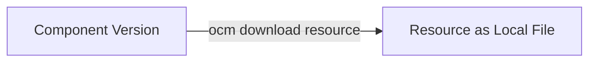

## Goal

Download resources from a component version using the OCM CLI.
Learn how to fetch specific resources, optionally transform them to their native format,
and save them to your local filesystem.

## You'll end up with

- A resource file downloaded from a component version
- Optionally a resource transformed to its native format (e.g., Helm chart `.tgz`)

**Estimated time:** ~5 minutes

## How it works



The OCM CLI fetches a specific resource from a component version and saves it to your local filesystem.

## Supported Access Types

`ocm download resource` works natively, without any plugin, for every access type that has a
built-in resource repository. Plugins extend OCM with support for additional, custom access types.
See [Reference: Resource Repositories]()
for the complete list of built-in types, including credential resolution and upload support.

## Prerequisites

- [OCM CLI installed]()
- [jq](https://jqlang.org) installed for JSON parsing (optional)
- A component version with resources to download (see [Create Component Versions]())

## Download Workflow

As mentioned in the [concept document for Component Identity](),
components can be stored in OCI registries or local CTF archives, but the way you access them is the same — using their unique identity.

The following examples show component versions stored in a local CTF archive and in a remote OCI registry.
The local CTF uses the component created in the [Getting Started: Create Component Versions]() tutorial,
while the remote OCI registry uses the OCM controller component, which the OCM project publishes to GitHub Container Registry with every release.







### List the available resources

First, check which resources are available in the component version. Until the OCM CLI supports resource listing,
you can use the [`ocm get cv`]() command
to see the complete component version descriptor, including the `resources` section.

```shell
ocm get cv ghcr.io/open-component-model//ocm.software/kubernetes/controller:0.25.0 -oyaml
```

<details>
<summary>Inspect the component for resources</summary>

The output shows the component version descriptor.
We're interested in the `chart` resource, which is a Helm chart stored as OCI artifact in an OCI registry.
The Sigstore signature value is shortened here.

```yaml
- component:
    componentReferences: null
    name: ocm.software/kubernetes/controller
    provider: ocm.software
    repositoryContexts: null
    resources:
    - access:
        imageReference: ghcr.io/open-component-model/kubernetes/controller:0.25.0@sha256:712ecadea9ce9fd0261793cb56b8371d297c6a75cd953e7984202d64c1e169c3
        type: ociArtifact
      digest:
        hashAlgorithm: SHA-256
        normalisationAlgorithm: ociArtifactDigest/v1
        value: 712ecadea9ce9fd0261793cb56b8371d297c6a75cd953e7984202d64c1e169c3
      name: image
      relation: local
      type: ociImage
      version: 0.25.0
    - access:
        imageReference: ghcr.io/open-component-model/kubernetes/controller/chart:0.25.0@sha256:1f015b13775bf4a71f147748527bf0b014b68aac0075ca47db40d09e5e494dc9
        type: ociArtifact
      digest:
        hashAlgorithm: SHA-256
        normalisationAlgorithm: ociArtifactDigest/v1
        value: 1f015b13775bf4a71f147748527bf0b014b68aac0075ca47db40d09e5e494dc9
      name: chart
      relation: local
      type: helmChart
      version: 0.25.0
    sources: null
    version: 0.25.0
  meta:
    schemaVersion: v2
  signatures:
  - digest:
      hashAlgorithm: SHA-256
      normalisationAlgorithm: jsonNormalisation/v4alpha3
      value: 73444afd0c3b6ee34c2be51e9efebea17cceed5e02d4072ef49f651a35bfbd67
    name: default
    signature:
      algorithm: Sigstore/v1alpha1
      mediaType: application/vnd.dev.sigstore.bundle.v0.3+json
      value: eyJtZWRpYVR5cGUiOiJhcHBsaWNhdGlvbi92bmQuZGV2LnNpZ3N0b3JlLmJ1bmRsZS52MC4zK2pzb24i...
```

</details>


 

### Download the resource

Use the `ocm download resource` command with the `--identity` flag to specify which resource to download.
We download the `chart` resource, which is a Helm chart:

```shell
 ocm download resource ghcr.io/open-component-model//ocm.software/kubernetes/controller:0.25.0 \
   --identity name=chart \
    --output helmchart-oci
 ```

<details>
<summary >You should see this output</summary>

```text
time=2026-11-24T14:15:41.732+01:00 level=INFO msg="resource downloaded successfully" output=helmchart-oci
```

</details>




### Verify the Download

Check that the downloaded resource exists and has content:

```shell
ls -la helmchart-oci
```

The downloaded Helm chart is in OCI blob format. 

```shell
total 16
drwxr-xr-x  5 user  staff  160 Nov 24 14:15 .
drwxr-xr-x  5 user  staff  160 Nov 24 14:15 ..
drwxr-xr-x  3 user  staff   96 Nov 24 14:15 blobs
-rw-r--r--  1 user  staff  819 Nov 24 14:15 index.json
-rw-r--r--  1 user  staff   30 Nov 24 14:15 oci-layout
```

```shell
jq . helmchart-oci/index.json
```

```json
{
  "schemaVersion": 2,
  "manifests": [
    {
      "mediaType": "application/vnd.oci.image.manifest.v1+json",
      "digest": "sha256:1f015b13775bf4a71f147748527bf0b014b68aac0075ca47db40d09e5e494dc9",
      "size": 816,
      "annotations": {
        "org.opencontainers.image.ref.name": "ghcr.io/open-component-model/kubernetes/controller/chart:0.25.0@sha256:1f015b13775bf4a71f147748527bf0b014b68aac0075ca47db40d09e5e494dc9",
        "software.ocm.layout.root": "true"
      }
    },
    {
      "mediaType": "application/vnd.oci.image.manifest.v1+json",
      "digest": "sha256:d2c013856d90e894c7d1ce6b398de515072e26fed268228164a228bb3a9276ba",
      "size": 815,
      "annotations": {
        "dev.sigstore.bundle.content": "dsse-envelope",
        "dev.sigstore.bundle.predicateType": "https://slsa.dev/provenance/v1",
        "org.opencontainers.image.created": "2026-11-20T19:35:34.956Z"
      },
      "artifactType": "application/vnd.dev.sigstore.bundle.v0.3+json"
    }
  ]
}
```










### List available resources

First, check which resources are available in the component version. Until the OCM CLI supports resource listing,
you can use the [`ocm get cv`]() command
to see the complete component version descriptor, including the `resources` section.

```shell
ocm get cv /tmp/helloworld/transport-archive//github.com/acme.org/helloworld:1.0.0 -oyaml
```

<details>
<summary>Inspect the component for resources</summary>

The output shows the component version descriptor. We're interested in the `mylocalfile` resource, which is a plain text file.

```yaml
- component:
    componentReferences: null
    name: github.com/acme.org/helloworld
    provider: acme.org
    repositoryContexts: null
    resources:
      - access:
          localReference: sha256:70a2577d7b649574cbbba99a2f2ebdf27904a4abf80c9729923ee67ea8d2d9d8
          mediaType: text/plain; charset=utf-8
          type: LocalBlob/v1
        digest:
          hashAlgorithm: SHA-256
          normalisationAlgorithm: genericBlobDigest/v1
          value: 70a2577d7b649574cbbba99a2f2ebdf27904a4abf80c9729923ee67ea8d2d9d8
        name: mylocalfile
        relation: local
        type: blob
        version: 1.0.0
      - access:
          imageReference: ghcr.io/stefanprodan/podinfo:6.9.1@sha256:262578cde928d5c9eba3bce079976444f624c13ed0afb741d90d5423877496cb
          type: OCIImage/v1
        digest:
          hashAlgorithm: SHA-256
          normalisationAlgorithm: genericBlobDigest/v1
          value: 262578cde928d5c9eba3bce079976444f624c13ed0afb741d90d5423877496cb
        name: image
        relation: external
        type: ociImage
        version: 1.0.0
    sources: null
    version: 1.0.0
  meta:
    schemaVersion: v2
```

</details>




### Download resource

Use the `ocm download resource` command with the `--identity` flag to specify which resource to download.
We download the `mylocalfile` resource, which is a plain text file:

```shell
 ocm download resource /tmp/helloworld/transport-archive//github.com/acme.org/helloworld:1.0.0 \
   --identity name=mylocalfile \
   --output mylocalfile-downloaded
 ```

<details>
<summary >You should see this output</summary>

```text
{"time":"2026-04-10T11:01:02.313565+02:00","level":"INFO","msg":"capabilities sent"}
time=2026-04-10T11:01:02.320+02:00 level=INFO msg="resource downloaded successfully" output=mylocalfile-downloaded
```

</details>




### Verify Download

Check that the downloaded resource exists and has content:

```shell
ls -la mylocalfile-downloaded
```

```shell
-rw------- 1 D032990 45 Apr. 10 11:01 mylocalfile-downloaded
```

```shell
cat mylocalfile-downloaded
```

```text
My first local Resource for an OCM component
```







## Using Transformers

To download resources in their native format instead of OCI blob format, use the `--transformer` flag.

In this example, we download the Helm chart resource using the `helm` transformer,
which converts the OCI blob back into a standard Helm chart archive.
The Helm chart is downloaded into a directory specified by `--output`.

```shell
ocm download resource ghcr.io/open-component-model//ocm.software/kubernetes/controller:0.25.0 \
  --identity name=chart \
  --output helmchart-tgz \
  --transformer helm
```

<details>
<summary>You should see this output</summary>

```text
time=2026-11-24T14:15:42.637+01:00 level=INFO msg="transforming resource..."
time=2026-11-24T14:15:45.716+01:00 level=INFO msg="resource transformed successfully"
time=2026-11-24T14:15:45.717+01:00 level=INFO msg="resource downloaded successfully" output=helmchart-tgz
```
</details>


The `helm` transformer is for a chart stored as an OCI artifact. A chart stored
as a chart archive (`.tgz`) needs no transformer: `--extraction-policy disable`
writes the `.tgz`.



The downloaded archive is now a regular Helm chart archive:

```shell
tar tvf helmchart-tgz/chart-0.25.0.tgz
```

```shell
-rw-r--r--  0 0      0         447 Nov 20 20:34 chart/Chart.yaml
-rw-r--r--  0 0      0        8844 Nov 20 20:35 chart/values.yaml
-rw-r--r--  0 0      0       14993 Nov 20 20:34 chart/values.schema.json
-rw-r--r--  0 0      0         863 Nov 20 20:34 chart/templates/NOTES.txt
-rw-r--r--  0 0      0        2514 Nov 20 20:34 chart/templates/_helpers.tpl
-rw-r--r--  0 0      0       16559 Nov 20 20:34 chart/templates/crd/components.delivery.ocm.software.yaml
-rw-r--r--  0 0      0       14456 Nov 20 20:34 chart/templates/crd/deployers.delivery.ocm.software.yaml
-rw-r--r--  0 0      0       20599 Nov 20 20:34 chart/templates/crd/discoveries.delivery.ocm.software.yaml
-rw-r--r--  0 0      0       16211 Nov 20 20:34 chart/templates/crd/namespaceddeployers.delivery.ocm.software.yaml
-rw-r--r--  0 0      0       17817 Nov 20 20:34 chart/templates/crd/replications.delivery.ocm.software.yaml
-rw-r--r--  0 0      0       12451 Nov 20 20:34 chart/templates/crd/repositories.delivery.ocm.software.yaml
-rw-r--r--  0 0      0       23042 Nov 20 20:34 chart/templates/crd/resources.delivery.ocm.software.yaml
-rw-r--r--  0 0      0       12865 Nov 20 20:34 chart/templates/manager/manager.yaml
-rw-r--r--  0 0      0        2048 Nov 20 20:34 chart/templates/manager/networkpolicy.yaml
-rw-r--r--  0 0      0         754 Nov 20 20:34 chart/templates/manager/ocm-config.yaml
-rw-r--r--  0 0      0        1038 Nov 20 20:34 chart/templates/monitoring/service.yaml
-rw-r--r--  0 0      0        1241 Nov 20 20:34 chart/templates/monitoring/servicemonitor.yaml
-rw-r--r--  0 0      0         977 Nov 20 20:34 chart/templates/rbac/aggregate-to-edit-role.yaml
-rw-r--r--  0 0      0        1320 Nov 20 20:34 chart/templates/rbac/aggregate-to-view-role.yaml
-rw-r--r--  0 0      0         844 Nov 20 20:34 chart/templates/rbac/component-editor-role.yaml
-rw-r--r--  0 0      0         777 Nov 20 20:34 chart/templates/rbac/component-viewer-role.yaml
-rw-r--r--  0 0      0         470 Nov 20 20:34 chart/templates/rbac/controller-manager.yaml
-rw-r--r--  0 0      0         841 Nov 20 20:34 chart/templates/rbac/deployer-editor-role.yaml
-rw-r--r--  0 0      0         774 Nov 20 20:34 chart/templates/rbac/deployer-viewer-role.yaml
-rw-r--r--  0 0      0         846 Nov 20 20:34 chart/templates/rbac/discovery-editor-role.yaml
-rw-r--r--  0 0      0         779 Nov 20 20:34 chart/templates/rbac/discovery-viewer-role.yaml
-rw-r--r--  0 0      0         925 Nov 20 20:34 chart/templates/rbac/leader-election-role.yaml
-rw-r--r--  0 0      0         857 Nov 20 20:34 chart/templates/rbac/leader-election-rolebinding.yaml
-rw-r--r--  0 0      0        1580 Nov 20 20:34 chart/templates/rbac/manager-role.yaml
-rw-r--r--  0 0      0         815 Nov 20 20:34 chart/templates/rbac/manager-rolebinding.yaml
-rw-r--r--  0 0      0         871 Nov 20 20:34 chart/templates/rbac/namespaceddeployer-editor-role.yaml
-rw-r--r--  0 0      0        1690 Nov 20 20:34 chart/templates/rbac/namespaceddeployer-impersonation-role.yaml
-rw-r--r--  0 0      0         804 Nov 20 20:34 chart/templates/rbac/namespaceddeployer-viewer-role.yaml
-rw-r--r--  0 0      0         850 Nov 20 20:34 chart/templates/rbac/replication-editor-role.yaml
-rw-r--r--  0 0      0         783 Nov 20 20:34 chart/templates/rbac/replication-viewer-role.yaml
-rw-r--r--  0 0      0         849 Nov 20 20:34 chart/templates/rbac/repository-editor-role.yaml
-rw-r--r--  0 0      0         782 Nov 20 20:34 chart/templates/rbac/repository-viewer-role.yaml
-rw-r--r--  0 0      0         841 Nov 20 20:34 chart/templates/rbac/resource-editor-role.yaml
-rw-r--r--  0 0      0         774 Nov 20 20:34 chart/templates/rbac/resource-viewer-role.yaml
-rw-r--r--  0 0      0        1186 Nov 20 20:34 chart/templates/webhook/certificate.yaml
-rw-r--r--  0 0      0         775 Nov 20 20:34 chart/templates/webhook/service.yaml
-rw-r--r--  0 0      0       12824 Nov 20 20:34 chart/README.md
```



## Controlling the Output Filename

Use `--output` to set the destination path explicitly. This is required whenever the default name is unsuitable — for example, Windows requires `.exe` for PATH-based invocation:

```shell
ocm download resource ghcr.io/open-component-model//ocm.software/cli: \
  --identity name=cli,os=windows,architecture=amd64 \
  --output ./ocm.exe
```

Without `--output`, the filename is the resource name:

```shell
# resource name=cli → file: cli
ocm download resource ghcr.io/open-component-model//ocm.software/cli: --identity name=cli,os=linux,architecture=amd64
```

## Specifying Resource Identity

If multiple resources share the same name, use additional identity attributes:

```shell
ocm download resource <repo>//<component>:<version> \
  --identity name=image,version=1.0.0 \
  --output image.tar
```

## CLI Reference

| Command | Description |
| --- | --- |
| [`ocm download resource`]() | Download a specific resource |
| [`ocm get cv`]() | Get component versions and resources |

## Related Documentation

- [Concept: Component Identity]() - Understanding component structure
- [Getting Started: Create Component Versions]() - Learn how to create components
