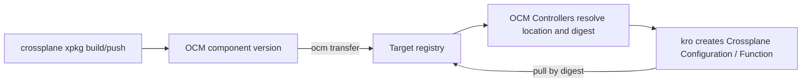

In this tutorial, you package a Crossplane Configuration and the Function it depends on in an OCM component version,
transfer them to the registry your cluster pulls from, and let the OCM Controllers and kro install them into
Crossplane, pinned by digest.

## What You'll Learn

By the end of this tutorial, you will:

- Build a Crossplane Configuration package (`.xpkg`) and add it to an OCM component version as a regular OCI resource
- Transfer the packages to a target registry, either as standalone OCI images or embedded in the component version
- Install the packages with a kro `ResourceGraphDefinition` that reads the location and digest the OCM Controllers resolve
- Verify the result by creating a composite resource from the API that the Configuration installed

## How It Works

A Crossplane package is an OCI image. Crossplane pulls it from a registry when you create a `Configuration`, `Function`,
or `Provider` object. OCM stores and transfers OCI images natively, so an `.xpkg` is a regular OCM resource with an
`OCIImage/v1` access. You don't need a conversion step or a custom resource type.



The component version is the single source of truth for which package versions belong together. After a transfer,
the OCM Controllers read the package locations from the component version in the target registry. Crossplane then pulls
each package from there by digest, never from the original source.

**Estimated time:** ~20 minutes

## Prerequisites


Before starting, make sure you have set up your environment as described in the [setup guide]().


- [Controller environment]() with the OCM Controllers and kro installed. You don't need Flux or Argo CD.
- [Crossplane v2](https://docs.crossplane.io/latest/get-started/install/) installed in the same cluster:

  ```shell
  helm repo add crossplane-stable https://charts.crossplane.io/stable
  helm install crossplane crossplane-stable/crossplane \
    --namespace crossplane-system --create-namespace
  ```

- [Crossplane CLI](https://docs.crossplane.io/latest/cli/) installed, to build `.xpkg` files
- [OCM CLI]() installed
- Access to an OCI registry that your cluster can pull from (e.g.,
  [ghcr.io](https://docs.github.com/en/packages/learn-github-packages/introduction-to-github-packages)).
  The kubelet on your nodes must also reach this registry, because Function and Provider packages run as pods.
- [skopeo](https://github.com/containers/skopeo) installed, if you want to embed a local `.xpkg` file instead of
  pushing it first
- `envsubst` installed (pre-installed on most Linux/macOS systems; part of `gettext`)


If you use a private registry, three parties need credentials: the OCM CLI, the OCM Controllers, and Crossplane.
The [Verify the transfer](#verify-the-transfer) step shows how to configure each of them.


## Scenario

Your platform team publishes Crossplane packages to a registry such as Artifactory, and your clusters install them
from there. You want one versioned, signable unit that says which package versions belong together, and that you can
move to any registry, including an air-gapped one.

You build an `App` API as a Configuration package that renders a `ConfigMap` with
`function-patch-and-transform`, ship both packages in the component `ocm.software/examples/crossplane-app`, and
install them into Crossplane.

## Environment Setup

Set environment variables for your GitHub username and the registries you use throughout. Replace them with your
own registries, for example an Artifactory OCI repository, if you don't use GitHub Container Registry:

```shell
export GITHUB_USERNAME=<your-github-username>
# Where your team publishes .xpkg files today
export XPKG_REGISTRY=ghcr.io/$GITHUB_USERNAME/crossplane
# The OCM repository your clusters read from; can be the same registry
export OCM_REPO=ghcr.io/$GITHUB_USERNAME/ocm-tutorial
```

## Tutorial Steps




### Build and publish the Crossplane package

If your team already publishes `.xpkg` files, you can reference one of those instead and continue with the next step.

The example Configuration defines an `App` API that renders a `ConfigMap`. Its Composition calls
`function-patch-and-transform`, so the Function is a dependency of the Configuration.

```shell
mkdir -p /tmp/xpkg-ocm/package && cd /tmp/xpkg-ocm

cat > package/crossplane.yaml << 'EOF'
apiVersion: meta.pkg.crossplane.io/v1
kind: Configuration
metadata:
  name: configuration-app
spec:
  crossplane:
    version: ">=v2.0.0"
  dependsOn:
    - apiVersion: pkg.crossplane.io/v1
      kind: Function
      package: xpkg.crossplane.io/crossplane-contrib/function-patch-and-transform
      version: ">=v0.11.0"
EOF

cat > package/definition.yaml << 'EOF'
apiVersion: apiextensions.crossplane.io/v2
kind: CompositeResourceDefinition
metadata:
  name: apps.example.ocm.software
spec:
  group: example.ocm.software
  names:
    kind: App
    plural: apps
  scope: Namespaced
  versions:
    - name: v1alpha1
      served: true
      referenceable: true
      schema:
        openAPIV3Schema:
          type: object
          properties:
            spec:
              type: object
              properties:
                message:
                  type: string
              required:
                - message
EOF

cat > package/composition.yaml << 'EOF'
apiVersion: apiextensions.crossplane.io/v1
kind: Composition
metadata:
  name: apps.example.ocm.software
spec:
  compositeTypeRef:
    apiVersion: example.ocm.software/v1alpha1
    kind: App
  mode: Pipeline
  pipeline:
    - step: render-configmap
      functionRef:
        name: crossplane-contrib-function-patch-and-transform
      input:
        apiVersion: pt.fn.crossplane.io/v1beta1
        kind: Resources
        resources:
          - name: config
            base:
              apiVersion: v1
              kind: ConfigMap
              data: {}
            patches:
              - type: FromCompositeFieldPath
                fromFieldPath: spec.message
                toFieldPath: data.message
            readinessChecks:
              - type: None
EOF
```

Build the package and push it:

```shell
crossplane xpkg build --package-root=package --package-file=configuration-app.xpkg
crossplane xpkg push -f configuration-app.xpkg $XPKG_REGISTRY/configuration-app:v0.1.0
```




### Add the packages to a component version

Reference each package as a resource with `OCIImage/v1` access. Choose how to add the Configuration package:




Use this if your pipeline already pushes `.xpkg` files to a registry.

```shell
cat > component-constructor.yaml << EOF
components:
  - name: ocm.software/examples/crossplane-app
    version: 0.1.0
    provider:
      name: ocm.software
    resources:
      - name: configuration-app
        type: ociImage
        version: 0.1.0
        access:
          type: OCIImage/v1
          imageReference: $XPKG_REGISTRY/configuration-app:v0.1.0
      - name: function-patch-and-transform
        type: ociImage
        version: v0.11.0
        relation: external
        access:
          type: OCIImage/v1
          imageReference: xpkg.crossplane.io/crossplane-contrib/function-patch-and-transform:v0.11.0
EOF
```




Use this to put a package into the component version without pushing it anywhere first.

`crossplane xpkg build` writes a Docker image tarball, but OCM embeds OCI image layouts. Convert the file with
[skopeo](https://github.com/containers/skopeo). The conversion switches to OCI media types, so the
embedded package gets a different digest than a pushed `.xpkg`.

```shell
skopeo copy docker-archive:configuration-app.xpkg oci-archive:configuration-app.tar
```

```shell
cat > component-constructor.yaml << EOF
components:
  - name: ocm.software/examples/crossplane-app
    version: 0.1.0
    provider:
      name: ocm.software
    resources:
      - name: configuration-app
        type: ociImage
        version: 0.1.0
        input:
          type: File/v1
          path: ./configuration-app.tar
          mediaType: application/vnd.ocm.software.oci.layout.v1+tar
      - name: function-patch-and-transform
        type: ociImage
        version: v0.11.0
        relation: external
        access:
          type: OCIImage/v1
          imageReference: xpkg.crossplane.io/crossplane-contrib/function-patch-and-transform:v0.11.0
EOF
```




The resource `type` is free-form. This guide uses `ociImage` because an `.xpkg` is an OCI image. Use a dedicated type
such as `crossplanePackage` if downstream tooling needs to tell packages apart from container images.
Provider packages work the same way as the Function here.

Build the component version into a local CTF archive:

```shell
ocm add cv
```

<details>
<summary>You should see this output</summary>

```text
 COMPONENT                            │ VERSION │ PROVIDER
──────────────────────────────────────┼─────────┼──────────────
 ocm.software/examples/crossplane-app │ 0.1.0   │ ocm.software
```

</details>

Check that OCM pinned each package by digest. The `OCIImage/v1` access only names a tag, but `ocm add cv` resolves
it and records the manifest digest in the component descriptor. The RGD later builds the package reference from this
digest, so Crossplane installs exactly the package you built the component version from, even if someone moves the
tag afterwards:

```shell
ocm get cv transport-archive//ocm.software/examples/crossplane-app:0.1.0 -o yaml
```

<details>
<summary>You should see this output (excerpt for <code>function-patch-and-transform</code>)</summary>

```yaml
resources:
  - access:
      imageReference: xpkg.crossplane.io/crossplane-contrib/function-patch-and-transform:v0.11.0@sha256:677ad7d06eab2da219c9f28a7f6393fd74e5cfe445b98e324a23736163fb4e99
      type: OCIImage/v1
    digest:
      hashAlgorithm: SHA-256
      normalisationAlgorithm: ociArtifactDigest/v1
      value: 677ad7d06eab2da219c9f28a7f6393fd74e5cfe445b98e324a23736163fb4e99
    name: function-patch-and-transform
    type: ociImage
    version: v0.11.0
```

</details>




### Transfer the component version to your registry

Copy the component version and its packages to `$OCM_REPO`.


If your registry requires authentication, configure [Credentials for OCM CLI]() first.


Choose where the packages land:




Each package becomes a normal image in the target registry. You can browse it in your registry UI, just like the
`.xpkg` files you publish today.

If you referenced a pushed package, the default OCI uploader relocates both packages:

```shell
cat > .ocmconfig << 'EOF'
type: generic.config.ocm.software/v1
configurations:
  - type: oci.uploader.transfer.config.ocm.software/v1alpha1
  - type: localblob.uploader.transfer.config.ocm.software/v1alpha1
EOF
```

If you embedded the `.xpkg` file, the Configuration package is a local blob without a `referenceName`. The default OCI
uploader only relocates local blobs that carry one, so the package would stay embedded in the component version. Use
this configuration instead. Its second entry names the image after the resource:

```shell
cat > .ocmconfig << 'EOF'
type: generic.config.ocm.software/v1
configurations:
  - type: oci.uploader.transfer.config.ocm.software/v1alpha1
  - type: oci.uploader.transfer.config.ocm.software/v1alpha1
    match: >-
      target.type == "OCIRepository" && resource.access.isType("LocalBlob")
      && has(resource.access.mediaType) && isOCIManifest(resource.access.mediaType)
    imageReference: >-
      ${target.baseUrl + (target.subPath == "" ? "" : "/" + target.subPath)
      + "/" + resource.name + ":" + resource.version}
  - type: localblob.uploader.transfer.config.ocm.software/v1alpha1
EOF
```

Transfer the component version:

```shell
ocm transfer cv transport-archive//ocm.software/examples/crossplane-app:0.1.0 $OCM_REPO
```




The packages are stored inside the component version's OCI index, so the component version is self-contained. This
fits air-gapped setups: transfer to a CTF archive, carry it across, and import it. See
[Transfer Components Across an Air Gap]().

```shell
cat > .ocmconfig << 'EOF'
type: generic.config.ocm.software/v1
configurations:
  - type: localblob.uploader.transfer.config.ocm.software/v1alpha1
EOF

ocm transfer cv transport-archive//ocm.software/examples/crossplane-app:0.1.0 $OCM_REPO
```




The CLI merges `.ocmconfig` from the current directory with your other OCM configuration, so your registry
credentials stay in effect. For details on uploaders, see
[Migrate from --upload-as to Uploader Configurations]().




### Verify the transfer

Check that the component version is available in the target registry and where its packages now live:

```shell
ocm get cv $OCM_REPO//ocm.software/examples/crossplane-app:0.1.0 -o yaml
```

<details>
<summary>You should see this output (standalone OCI images)</summary>

The descriptor in the target points at the relocated images. The OCI uploader keeps the source repository path below
`$OCM_REPO`:

```yaml
resources:
  - access:
      imageReference: ghcr.io/<your-github-username>/ocm-tutorial/<your-github-username>/crossplane/configuration-app:v0.1.0
      type: ociArtifact/v1
    name: configuration-app
  - access:
      imageReference: ghcr.io/<your-github-username>/ocm-tutorial/crossplane-contrib/function-patch-and-transform:v0.11.0
      type: ociArtifact/v1
    name: function-patch-and-transform
```

With the embedded `.xpkg` file, `configuration-app` lands at
`ghcr.io/<your-github-username>/ocm-tutorial/configuration-app:0.1.0` instead.

</details>

<details>
<summary>You should see this output (embedded in the component version)</summary>

The descriptor in the target holds local blobs. Each one is a native OCI manifest that you can pull as
`$OCM_REPO/component-descriptors/<component>@<localReference>`:

```yaml
resources:
  - access:
      localReference: sha256:677ad7d06eab2da219c9f28a7f6393fd74e5cfe445b98e324a23736163fb4e99
      mediaType: application/vnd.oci.image.index.v1+json
      referenceName: crossplane-contrib/function-patch-and-transform:v0.11.0
      type: LocalBlob/v1
    name: function-patch-and-transform
```

</details>

GitHub Container Registry creates new packages as private. To make them public, go to the `packages` tab of your
GitHub profile `https://github.com/$GITHUB_USERNAME?tab=packages`, and under "Package settings" change the
visibility of every package below `ocm-tutorial` that the transfer created to `public`.

Alternatively, if you want to keep your packages private, configure credentials for the OCM Controllers and Crossplane:


The **OCM Controllers** read the component version. Create a `docker-registry` secret in the namespace of the
instance you create later (here `default`). For GitHub Container Registry, you can use a short-lived token from the
GitHub CLI:

```shell
kubectl create secret docker-registry ghcr-secret \
  --namespace default \
  --docker-username=$GITHUB_USERNAME \
  --docker-password="$(gh auth token)" \
  --docker-server=ghcr.io
```

Then uncomment `ocmConfig` on the `Repository` in the RGD of the next step. The `Component` and `Resource` objects
inherit it. See [Configure Credentials for OCM Controllers]().

**Crossplane** pulls the packages, and the kubelet pulls the Function and Provider runtime images. Create the same
secret in Crossplane's namespace:

```shell
kubectl create secret docker-registry xpkg-pull-secret \
  --namespace crossplane-system \
  --docker-username=$GITHUB_USERNAME \
  --docker-password="$(gh auth token)" \
  --docker-server=ghcr.io
```

Then uncomment `packagePullSecrets` in the RGD. Crossplane passes the secret on to the runtime Deployments. Instead of
setting secrets per package, you can attach the secret to every package under a registry prefix with a Crossplane
[ImageConfig](https://docs.crossplane.io/latest/packages/image-configs/) (`spec.registry.authentication.pullSecretRef`).





### Create the ResourceGraphDefinition

The ResourceGraphDefinition (RGD) chains the OCM objects (`Repository`, `Component`, `Resource`) to the
Crossplane package objects (`Function`, `Configuration`):

```shell
cat > rgd.yaml << 'EOF'
apiVersion: kro.run/v1alpha1
kind: ResourceGraphDefinition
metadata:
  name: crossplane-app
spec:
  schema:
    apiVersion: v1alpha1
    kind: CrossplaneApp
    spec:
      # The component version to install. Changing it upgrades the Crossplane packages.
      version: string | default="0.1.0"
  resources:
    - id: repository
      readyWhen:
        - ${repository.status.conditions.exists(c, c.type == 'Ready' && c.status == 'True')}
      template:
        apiVersion: delivery.ocm.software/v1alpha1
        kind: Repository
        metadata:
          name: crossplane-app
        spec:
          repositorySpec:
            baseUrl: $OCM_REPO
            type: OCIRegistry
          interval: 1m
          # Required if the OCM repository needs credentials:
          # ocmConfig:
          #   - kind: Secret
          #     name: ghcr-secret
    - id: component
      readyWhen:
        - ${component.status.conditions.exists(c, c.type == 'Ready' && c.status == 'True')}
      template:
        apiVersion: delivery.ocm.software/v1alpha1
        kind: Component
        metadata:
          name: crossplane-app
        spec:
          repositoryRef:
            name: ${repository.metadata.name}
          component: ocm.software/examples/crossplane-app
          semver: ${schema.spec.version}
          interval: 1m
    # One Resource per package. The CEL expression builds a digest-pinned package reference from the
    # resolved location (standalone image or local blob) and the digest recorded in the component version.
    - id: functionPackage
      readyWhen:
        - ${functionPackage.status.conditions.exists(c, c.type == 'Ready' && c.status == 'True')}
      template:
        apiVersion: delivery.ocm.software/v1alpha1
        kind: Resource
        metadata:
          name: function-patch-and-transform
        spec:
          componentRef:
            name: ${component.metadata.name}
          resource:
            byReference:
              resource:
                name: function-patch-and-transform
          additionalStatusFields:
            package: >-
              resource.access.toOCI().registry + "/" + resource.access.toOCI().repository
              + "@sha256:" + resource.digest.value
    - id: configurationPackage
      readyWhen:
        - ${configurationPackage.status.conditions.exists(c, c.type == 'Ready' && c.status == 'True')}
      template:
        apiVersion: delivery.ocm.software/v1alpha1
        kind: Resource
        metadata:
          name: configuration-app
        spec:
          componentRef:
            name: ${component.metadata.name}
          resource:
            byReference:
              resource:
                name: configuration-app
          additionalStatusFields:
            package: >-
              resource.access.toOCI().registry + "/" + resource.access.toOCI().repository
              + "@sha256:" + resource.digest.value
    # "function" is a reserved kro identifier, hence the prefixed IDs.
    - id: crossplaneFunction
      readyWhen:
        - ${crossplaneFunction.status.conditions.exists(c, c.type == 'Healthy' && c.status == 'True')}
      template:
        apiVersion: pkg.crossplane.io/v1
        kind: Function
        metadata:
          # Must match functionRef.name in the Composition.
          name: crossplane-contrib-function-patch-and-transform
        spec:
          package: ${functionPackage.status.additional.package}
          # Required if the target registry needs credentials:
          # packagePullSecrets:
          #   - name: xpkg-pull-secret
    - id: crossplaneConfiguration
      readyWhen:
        - ${crossplaneConfiguration.status.conditions.exists(c, c.type == 'Healthy' && c.status == 'True')}
      template:
        apiVersion: pkg.crossplane.io/v1
        kind: Configuration
        metadata:
          name: configuration-app
        spec:
          package: ${configurationPackage.status.additional.package}
          # Dependencies come from the component version, not from Crossplane's resolver.
          skipDependencyResolution: true
          # packagePullSecrets:
          #   - name: xpkg-pull-secret
EOF
```

Key points:

- `resource.access.toOCI()` returns the registry and repository of the package wherever the transfer put it. For a
  local blob it derives them from the `Repository` base URL. Appending the resource digest from the component
  descriptor pins the package even when the relocated reference only carries a tag.
- `skipDependencyResolution: true` stops Crossplane from pulling the Function from the registry named in
  `crossplane.yaml`. The RGD installs the Function from the component version instead.
- The `Function` name must match `functionRef.name` in the Composition. `crossplane-contrib-function-patch-and-transform`
  is also the name that Crossplane's dependency resolver would generate.

kro needs permission to manage every kind the RGD templates, and the `CrossplaneApp` kind it generates. Grant it with
a `ClusterRole` labeled for kro's [aggregation mode](https://kro.run/docs/advanced/access-control). If kro runs in
`unrestricted` mode, the role is redundant but harmless:

```shell
cat > kro-rbac.yaml << 'EOF'
apiVersion: rbac.authorization.k8s.io/v1
kind: ClusterRole
metadata:
  name: kro-crossplane-app
  labels:
    rbac.kro.run/aggregate-to-controller: "true"
rules:
  - apiGroups: ["kro.run"]
    resources: ["crossplaneapps"]
    verbs: ["create", "delete", "get", "list", "patch", "update", "watch"]
  - apiGroups: ["kro.run"]
    resources: ["crossplaneapps/status"]
    verbs: ["get", "patch", "update"]
  - apiGroups: ["delivery.ocm.software"]
    resources: ["repositories", "components", "resources"]
    verbs: ["create", "delete", "get", "list", "patch", "update", "watch"]
  - apiGroups: ["pkg.crossplane.io"]
    resources: ["functions", "configurations"]
    verbs: ["create", "delete", "get", "list", "patch", "update", "watch"]
EOF

kubectl apply -f kro-rbac.yaml
```

If you bind kro's permissions explicitly instead of through aggregation, bind this role to kro's `ServiceAccount` as
described in [RBAC for CRDs kro creates at runtime]().

Apply the RGD:

```shell
envsubst < rgd.yaml | kubectl apply -f -
kubectl get rgd crossplane-app
```

<details>
<summary>You should see this output</summary>

```text
NAME             APIVERSION   KIND            STATE    READY   AGE
crossplane-app   v1alpha1     CrossplaneApp   Active   True    8s
```

</details>




### Install the packages

```shell
cat > instance.yaml << 'EOF'
apiVersion: kro.run/v1alpha1
kind: CrossplaneApp
metadata:
  name: crossplane-app
spec:
  version: 0.1.0
EOF

kubectl apply -f instance.yaml
kubectl get crossplaneapp crossplane-app -w
```

<details>
<summary>You should see this output</summary>

```text
NAME             STATE    READY   AGE
crossplane-app   ACTIVE   True    2m
```

</details>

Check that Crossplane installed both packages from the target registry:

```shell
kubectl get functions.pkg.crossplane.io,configurations.pkg.crossplane.io
```

<details>
<summary>You should see this output (standalone OCI images)</summary>

```text
NAME                                                                         INSTALLED   HEALTHY   PACKAGE
function.pkg.crossplane.io/crossplane-contrib-function-patch-and-transform   True        True      ghcr.io/<your-github-username>/ocm-tutorial/crossplane-contrib/function-patch-and-transform@sha256:677ad7d0...

NAME                                                INSTALLED   HEALTHY   PACKAGE
configuration.pkg.crossplane.io/configuration-app   True        True      ghcr.io/<your-github-username>/ocm-tutorial/<your-github-username>/crossplane/configuration-app@sha256:5d7a04b0...
```

With embedded packages, `PACKAGE` reads
`ghcr.io/<your-github-username>/ocm-tutorial/component-descriptors/ocm.software/examples/crossplane-app@sha256:...`.

</details>




### Use the installed API

Create a composite resource from the `App` API that the Configuration installed:

```shell
cat << 'EOF' | kubectl apply -f -
apiVersion: example.ocm.software/v1alpha1
kind: App
metadata:
  name: hello
  namespace: default
spec:
  message: "Installed from an OCM component version"
EOF
```

Wait until Crossplane has composed the `App`:

```shell
kubectl wait app hello -n default --for=condition=Ready --timeout=2m
kubectl get app hello -n default
```

<details>
<summary>You should see this output</summary>

```text
app.example.ocm.software/hello condition met
NAME    SYNCED   READY   COMPOSITION                 AGE
hello   True     True    apps.example.ocm.software   15s
```

</details>

Read the message from the `ConfigMap` that the Composition rendered:

```shell
kubectl get configmap -n default -l crossplane.io/composite=hello \
  -o jsonpath='{.items[0].data.message}'
```

<details>
<summary>You should see this output</summary>

```text
Installed from an OCM component version
```

</details>




### Upgrade the packages

Change the package so that it gets a new digest. Here, you add a description to the package metadata:

```shell
cat > package/crossplane.yaml << 'EOF'
apiVersion: meta.pkg.crossplane.io/v1
kind: Configuration
metadata:
  name: configuration-app
  annotations:
    meta.crossplane.io/description: App API shipped with OCM
spec:
  crossplane:
    version: ">=v2.0.0"
  dependsOn:
    - apiVersion: pkg.crossplane.io/v1
      kind: Function
      package: xpkg.crossplane.io/crossplane-contrib/function-patch-and-transform
      version: ">=v0.11.0"
EOF
```

Rebuild the package as `v0.2.0`, and publish a component version `0.2.0` that references it:

```shell
crossplane xpkg build --package-root=package --package-file=configuration-app.xpkg
crossplane xpkg push -f configuration-app.xpkg $XPKG_REGISTRY/configuration-app:v0.2.0

sed -e 's/version: 0.1.0/version: 0.2.0/' \
    -e 's/configuration-app:v0.1.0/configuration-app:v0.2.0/' \
    component-constructor.yaml > component-constructor.next.yaml
mv component-constructor.next.yaml component-constructor.yaml

ocm add cv
ocm transfer cv transport-archive//ocm.software/examples/crossplane-app:0.2.0 $OCM_REPO
```

If you embedded the `.xpkg` file, re-run the `skopeo copy` command instead of `crossplane xpkg push`.

Point the instance at the new component version:

```shell
kubectl patch crossplaneapp crossplane-app --type merge -p '{"spec":{"version":"0.2.0"}}'
kubectl get configurations.pkg.crossplane.io configuration-app
```

The OCM Controllers resolve the new component version, kro updates `spec.package` on the `Configuration`, and
Crossplane rolls out a new package revision with the new digest.




## What you've learned

- A Crossplane `.xpkg` is an OCI image, so it is an ordinary OCM resource with `OCIImage/v1` access, and OCM pins its
  digest when you build the component version
- Uploader configurations decide whether `ocm transfer` relocates packages as standalone OCI images or embeds them in
  the component version
- `resource.access.toOCI()` plus the resource digest gives Crossplane a digest-pinned package reference wherever the
  transfer put the package
- `skipDependencyResolution` hands dependency management from Crossplane to the component version

**For deeper understanding:**

- [Concept: OCM Controllers]()
- [Concept: Transfer and Transport]()

## Check your understanding

1. Why does Crossplane pull the packages from `$OCM_REPO` and not from `$XPKG_REGISTRY`?
2. Why does the RGD append `resource.digest.value` instead of using the tag?
3. How would you add a Provider package to the component version?



- **Question 1:** The OCM Controllers read the package locations from the component version in `$OCM_REPO`, where
  `ocm transfer` rewrote them. kro passes those locations to Crossplane.
- **Question 2:** After a transfer with the OCI uploader, the relocated reference only carries a tag. The digest in the
  component descriptor is the one OCM recorded (and that a signature covers), so the package can't change underneath you.
- **Question 3:** Add another `OCIImage/v1` resource for the Provider package, a matching `Resource` in the RGD, and a
  `pkg.crossplane.io/v1` `Provider` object whose `spec.package` reads that resource's status, exactly like the Function.



## Going further

### Keep Crossplane's dependency resolution

If you prefer that Crossplane resolves `dependsOn` itself, transfer with the standalone OCI images option and redirect
the dependency registry to the target with an `ImageConfig`. The OCI uploader keeps the source repository path, so
`xpkg.crossplane.io/crossplane-contrib/function-patch-and-transform` lands at
`$OCM_REPO/crossplane-contrib/function-patch-and-transform`:

```yaml
apiVersion: pkg.crossplane.io/v1beta1
kind: ImageConfig
metadata:
  name: relocate-to-ocm-target
spec:
  matchImages:
    - type: Prefix
      prefix: xpkg.crossplane.io/
  rewriteImage:
    prefix: ghcr.io/<your-github-username>/ocm-tutorial/
```

Drop the `Function` and `skipDependencyResolution` from the RGD. Crossplane then installs the Function from the
rewritten location (`status.resolvedPackage` on the Function shows it). The trade-off: Crossplane picks the dependency
version from the constraint in `crossplane.yaml`, not from the component version, so the digest isn't pinned by OCM.

## Troubleshooting

### Symptom: Configuration is `Healthy=False` with missing dependencies

**Cause:** Crossplane tried to resolve `dependsOn` itself, or the `Function` name doesn't match `functionRef.name` in the
Composition.

**Fix:** Set `skipDependencyResolution: true` on the `Configuration` and name the `Function` exactly as the Composition
references it.

### Symptom: Function pod in `ImagePullBackOff`

**Cause:** Crossplane fetched the package, but the kubelet can't pull the same image to run the Function. This happens
when the nodes have no route or no credentials for the target registry.

**Fix:** Add `packagePullSecrets` to the `Function` (see [Verify the transfer](#verify-the-transfer)), and make sure
the nodes can reach and trust the registry.

### Symptom: `id function is a reserved keyword in KRO`

**Cause:** kro reserves some identifiers, `function` among them.

**Fix:** Use a different resource `id` in the RGD, for example `crossplaneFunction`.

## Cleanup

```shell
kubectl delete app hello -n default
kubectl delete -f instance.yaml
envsubst < rgd.yaml | kubectl delete -f -
kubectl delete -f kro-rbac.yaml
rm -rf /tmp/xpkg-ocm
```

Deleting the instance removes the `Function` and `Configuration` objects, and Crossplane uninstalls the packages.

## Next steps

- [How-to: Transfer Components Across an Air Gap]() - Move the component version and its packages into a disconnected registry
- [How-to: Verify Component Versions with the Controller]() - Check signatures before kro installs anything
- [Tutorial: Deploy a Helm Chart (with Bootstrap)]() - Ship the RGD itself in the component version and apply it with a `Deployer`

## Related documentation

- [Crossplane: Configurations](https://docs.crossplane.io/latest/packages/configurations/) and [Functions](https://docs.crossplane.io/latest/packages/functions/)
- [Tutorial: Working with OCI]() - Embed OCI image layouts and access them natively
